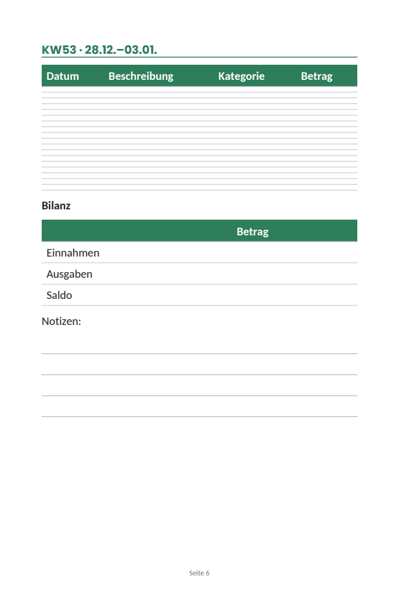
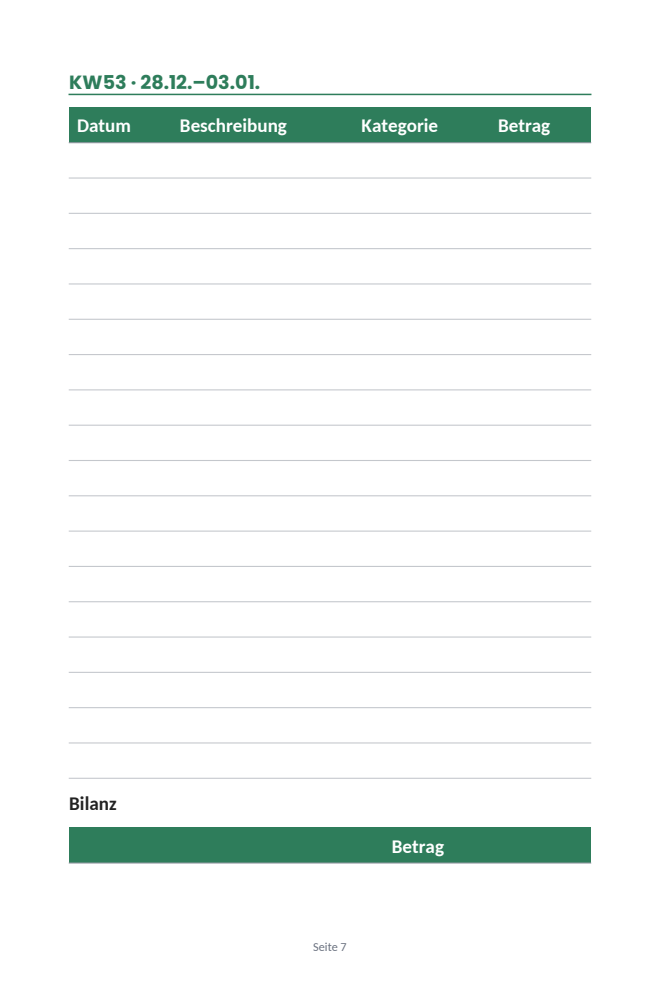
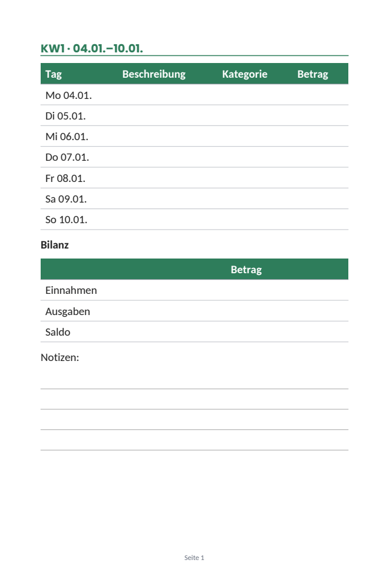

# Ember 0.38.0: what the diagnostics of 2026-10-14 show

*Your diagnostics report of 2026-10-14 10:17 UTC (version 0.38.0; cycles #269 to #280 in full, 04:20 to 10:01 Berlin
time), read against `6c38765` (0.38.1, the head of the tracked branch). 0.38.1 only adds the limit on sell requests;
no finding depends on it. Nothing in the app changes with this report.*

**Evidence.** I read the whole report (6,862 lines):
- the 12 newest cycles, with every call, reply and tool (106 tool calls);
- the planner's context as the next plan would see it;
- the records: projects, ventures, milestones, journal, approvals, messages, reviews, bets, cases, principles, the
  plan tree and its picks, the critic's checks, listings, pins, posts, the memory files and the workspace's text files,
  among them the KDP interior you rejected today;
- the integrations, the meta keys and the newest 200 events.

I checked every finding against the code. Labels, as in the earlier analyses:
- **live**: it is in your report.
- **code**: found by reading the code.
- **reproduced**: I ran Ember's own code on it. Here: I rendered the rejected book's interior (v13, taken from the
  report) with `products/markup.py`, `products/pdf.py` and `products/images.py`, with the versions pinned in
  `requirements.txt`. The report cuts that file after week 34; the pages shown are complete.

**Paths** are relative to `ember/app/`. **Times** are Berlin time unless they say UTC.

---

## 1. The short answer

- **The business has no traction yet.**
  - 17 views on 9 listings in 15 days, no favorite, no order, $0 revenue.
  - $92.93 of your $200 is spent. $107.07 at about $7 a day lasts 15 days, until about 10-29.
  - Your goal ($100 a month by 11-15) stands at 0%.
- **Your fifth rejection of the Haushaltsbuch (#109, today) is the renderer's fault, not the agent's** (section 3.1,
  reproduced).
  - `make_document` draws a table row whose cells are all empty 2.2 mm tall.
  - Each week's 18 "fill-in" rows came out as a band of lines 2.2 mm apart, with a third of the page empty below.
    That is exactly what you wrote: "the line spacing is still off completely … you want to generate a table … but
    it's just off".
  - Ember's own guide tells the agent to use "tables with empty rows" in printables.
  - The book has cost $12.89 and five of your reviews.
- **The 12 cycles in the report ($2.43) proposed nothing and sent nothing.**
  - Six cycles each parked one idea from a brainstorm made in your "nothing new" week. One cycle brainstormed six
    more, and one "paused" two of them: those come back as steps tomorrow (3.3).
  - Nine tried to tell you that milestones #15 and #16 will miss. Messages #189 (00:38) and #190 (03:50) had already
    told you. The daily limit refused all nine (3.2).
  - Ember's code shows the agent neither how many messages it sent today nor what they said. The result: 14 refused
    calls, and 8 of the agent's 18 lessons are now about that limit, 2 of them wrong (3.7).
- **The day's money was gone by 10:01**: $5.29 of $7 in 20 cycles since midnight, every sleep cut to 30 minutes. The
  rest is kept for event wake-ups until 20:00, when the next ordinary cycle runs; until then only your decisions wake
  Ember (3.9).
- **Three defects in the plan and the tools**:
  - Line #9, the "Pinterest traffic test", got a weekly Bluesky post and pin that no cycle can make (3.4).
  - The daily review's "stop" can't be carried out by the agent since 0.35.0. The review's own text still says
    "project_update closes any line" (3.5).
  - `plan_step` refuses a call that doesn't repeat the step's number, even for the cycle's own step: 4 refusals
    (3.6).
- **The critic hasn't passed a listing in 10 checks.** It scored 5 or 6 of 10; it passes at 7. Its fix steps weigh
  most, and 8 of the 12 cycles #257 to #268 went to them (3.8).
- **What works** (3.11):
  - every integration is healthy, the blog's SFTP login included;
  - your price table matches Anthropic's prices;
  - your approvals are carried out within seconds;
  - in the 12 cycles no request was refused for a full publishing queue: 0.37.9's limits hold.

---

## 2. Where the business stands: live

| | Now |
|---|---|
| Etsy | 7 listings, 15 views in all (0 to 4 each), 0 favorites, 0 orders; first ones live since 09-29 |
| Printify | 2 posters on Etsy, 1 view each, 0 orders |
| Pinterest | 15 pins, about 60 impressions, 1 click |
| Bluesky | 21 posts, 47 reactions (2.2 a post), 138 followers |
| KDP | Haushaltsbuch 2027: rejected 5 times (#77, #81, #84, #85, #109) |
| Money | $200 granted, $92.33 API + $0.60 Etsy fees spent, $0 revenue, $107.07 left |
| Spending | $49.34 in the last 7 days; today $5.29 of $7 by 10:01 |

Ember's own reviews name the bottleneck correctly: reach. Code can't fix that. What code can fix is how much of each
day goes to work that can't move it, and the book that would bring Amazon's search traffic.

---

## 3. Findings

### 3.1 The KDP book: an empty table row is drawn 2.2 mm tall: live, code, reproduced

**What happened.** The v13 interior has 53 weekly pages. Each has a header row ("Datum | Beschreibung | Kategorie |
Betrag") and 18 rows of empty cells (`| | | | |`), then a "Bilanz" table and four writing lines. The agent's
checklist (`books/checklist.md`) passed it: "KW53's 18-row table + Bilanz + Notizen fit cleanly on one page". You
rejected it: "the line spacing is still off completely. I looks like you want to generate a table for the weekly
overview but its just off."

**Why.** `products/pdf.py:549` gives a table row the height of its tallest cell, in lines:

```python
heights.append(max(len(cl) for cl in lines) * self.body_lh + 2 * pad_y)
```

An empty cell has no words, so `break_lines` (`pdf.py:646`) returns no lines. A row of empty cells is 0 lines plus
2 × 1.1 mm of padding: **2.2 mm**. The header row, which has words, is 8.15 mm at the book's 12.5 pt. So the 18 rows
take 40 mm between them, a ruled band no one can write in, and the page has room left at the bottom.



*Page 6 of v13, rendered by Ember's own code: 18 rows 2.2 mm apart.*

**Why the agent couldn't see it or fix it.**
- `agent/guides/documents.md:38` tells it: "Printables: one purpose per page; checklists, tables with empty rows and
  writing lines leave room to write."
- The Word copy draws every empty row at one line's height, because each cell holds an empty paragraph
  (`products/word.py:443-486`). So the PDF and the .docx of the same source disagree.
- `make_document` shows pictures of the first 4 pages only (`products/make.py:38`, `:109`). The first weekly page is
  page 6: the agent made its own pictures of it (`books/check-kw-page6.png`, `-page6b.png`) and passed it.
- On 10-10 (message #181) it found the cause half right ("empty cells collapse to ~5mm rows") and planned `::: lines`
  instead. v12 and v13 use `::: lines` for the notes but kept empty tables for the weekly logs, as v8 had (v13's weeks
  come from a workshop script that merged each week's two pages, cycle #248).

**The 18 rows only fit because they are 2.2 mm.** With a row one line tall (the change in section 5.1), the same week
needs two pages, and the Bilanz's header is left alone at the bottom of the first: the spill-over you rejected in #81.



*The same source with empty rows one line tall: 18 rows are a real table, but the Bilanz starts at the bottom and
runs onto the next page.*

I measured what one 6x9 page holds with writable rows: a heading, the log, the 3-row Bilanz and the note lines.

| Size | 4 note lines | 2 note lines |
|---|---|---|
| 12.5 pt (v13's) | 10 rows | 12 rows |
| 11 pt | 12 rows | 14 rows |
| 10.5 pt | 12 rows | 15 rows |

Your two demands (dense pages, nothing spilling over) can both be met, but at 10 to 15 rows a week, not 18.

**What works today, without a code change**: give every row something in its first cell. One row per day with its
date (Mo 04.01. … So 10.01.) draws full rows with today's renderer, and the week fits one page with the Bilanz and four
note lines:



### 3.2 Nine cycles tried to tell you what you had been told: live, code

**What happened.**
- At 00:05 Ember's code warned that first tests #15 (the blog's ad revenue) and #16 (a Printify order) are due 10-21
  unmet. From then on, OBLIGATIONS told every plan: "Work toward it first, or tell your owner once what it needs"
  (`agent/stages.py:497`).
- The agent told you twice:
  - message #189 (cycle #262, 00:38): "Accepting the miss on #15 … #16 is likely to be missed too";
  - message #190 (cycle #268, 03:50): "Also flagging: ventures #4 (POD) and #5 (blog/ads) first tests are due 10-21
    with 0 progress each".
- Those were today's two messages that answer none of yours (`store.MESSAGES_PER_DAY = 2`).
- From 04:20 on, cycles #269, #270, #271, #272, #274, #276, #277, #278 and #280 each tried to send the "heads-up"
  again. That was 14 refused calls: 9 for the daily limit, 3 for `"commits": "none"` without a `due`, 2 for a promise
  1 and 8 characters over its 100.

**Why.**
- The plan can't see what it already said.
  - YOUR LAST CYCLE lists what the last two cycles did, and names a message there by its number only ("message_owner
    (message #190)"), not its words (`agent/digest.py`).
  - #189 was seven cycles back.
  - STATUS doesn't say how many messages went out today (`agent/context.py:524-543`), and no other section does
    (`:970-1004`).
- #268's journal, the one line of its words the next plan sees, mentions the pin and not the flag in its message.
- The OBLIGATIONS line doesn't change once the owner has been told.
- The count exists: `plan.limits` reads it, and the report shows it ("messages today that answer none of the owner's 2
  of 2"). But only a step of kind "report" waits on it. This heads-up was no step: the agent took it from
  OBLIGATIONS.

**What the agent concluded instead** (lessons #c271, #c274): "the cap's 'day' boundary doesn't match CEST midnight".
It does: `_unasked_today` counts from the start of your day in Berlin (`agent/tools.py:3486-3488`). Both messages were
sent after midnight.

### 3.3 Six cycles to park six ideas, then a brainstorm for six more: live, code

**What happened.**
- Cycle #254 (10-13, 03:48) ran a "minimal brainstorm". Its own plan said it was in your "nothing new" week. It added
  ideas #28 to #33.
- Today each idea's "Triage it" step was the heaviest ready step, one a cycle, 30 minutes apart:
  - #269 parked #29, #270 #30, #271 #28, #272 #31, #273 #32, #274 #33;
  - each for the same reason, your rule and this week's review, and with no research spent;
  - $1.03 for six decisions the brainstorm cycle could have made at once. Cycle #279 shows it can: it parked four of
    its own six ideas in the same cycle.
- With no idea waiting, a brainstorm was due again (`agent/desk.py:135-147`: below `FUNNEL = 5` waiting ideas). Cycle
  #279 brainstormed #34 to #39 ($0.29). Cycle #280 "paused" #34 and #35 "until 10-20" ($0.21).
- Venture cycles cost $1.54 of today's $5.29. The whole chain cost $1.76 over two days: the brainstorm of 10-13
  ($0.23), today's six triages ($1.03), the second brainstorm ($0.29) and the pause ($0.21). It produced 12 ideas: 10
  parked, 2 paused, none researched.
- Your weekly look of 10-09 had already named this: "24 venture cycles ($10.45) scored and planned new ideas, and 14
  of them were later killed". Its Stop list starts with "Scoring, researching or planning new ventures".

**Why.**
- Your rulebook's "nothing new" and the review's Stop list are words for the planner; they don't change which step
  the plan takes. **Hold new things** does (`agent/plan.py:663`): no venture cycle and no new product. The 0.37.0
  analysis recommended it on 10-09. It isn't set (the Ventures node has no hold).
- A paused idea comes back. A venture's step moves with its stage, its evidence, cases or the critic's answers, not
  with a note. So #280's "pause" left step #187 waiting only until tomorrow (the 0.37.6 brake), and step #185 is ready
  now.
- A venture step can't wait for a date: `plan_step` needs a product line (`agent/tools.py:2330-2332`), and a venture
  cycle has none. Until 10-20 these two ideas take a cycle each, every day, to be paused again. A new brainstorm is
  also due again, as only 2 ideas wait.

### 3.4 Steps no cycle can do: line #9's Bluesky post and pin: live, code

**What happened.** Cycle #277 closed step #94, "Set the channel up with your owner", for line #9, the "Pinterest
traffic test". As the next cycle began, Ember's code added "This week's pin for Pinterest traffic test" (#182) and
"This week's Bluesky post for Pinterest traffic test" (#183). That cycle, marketing cycle #278, took #183. Its post
linked the Job Application Tracker, and the tool refused: "this cycle works on product line #9: no post for project
#5". The cycle ended with nothing made or proposed ($0.24).

**Why.**
- `_recurring` (`agent/plan.py:1719`) gives every live product in its maintain stage a weekly step for each channel
  its audience reads. It leaves out only KDP books (`:1733`).
- A channel line is a product of the `CHANNEL` template (`agent/templates.py:284`), with a maintain stage and no
  listing of its own.
- Its steps' checks count pins and posts that link the line's own listings, which don't exist. `_line`
  (`agent/tools.py:2897`) refuses a pin or post for another line's listing.
- So #182 and #183 can't pass. Each gets one try a day (the brake), a cycle each. A new pair comes every week.

### 3.5 A review's "stop" the agent can't carry out: live, code

**What happened.**
- The reviews of 10-13 and 10-14 said "stop" for line #10 (the blog's SEO and ads test).
- TODAY'S REVIEW tells the plan: "Act on it: carry out each stop now (project_update closes any line)"
  (`agent/review.py:794`).
- Cycle #275, on line #6, tried `project_update #10` with status "idea" and was refused, as work on another line.
  Cycle #276, on line #10, set it "waiting" and held its step.
- Cycle #262 had tried the same and failed too.

**Why.**
- Since 0.35.0 only you close or drop a project: `PROJECT_STATUSES = ("idea", "active", "waiting")`
  (`agent/tools.py:330`).
- The review's sentence is from 0.28.0.
- The next review counts "waiting" as open ("→ still waiting: you haven't carried it out", `review.py:628`), so it
  will ask again tomorrow.

### 3.6 `plan_step` without its step: live, code

Four calls were refused with "name the step (step_id)": two in #275, one each in #277 and #278. Each time the worker
put the number in `ref` or left it out (`plan_step` with action done or wait, `agent/plan.py:3082`). The step it meant
was the cycle's own, shown in YOUR STEP. The agent wrote two lessons about it; both were dropped within two cycles
(3.7).

### 3.7 The lessons file filled with one limit, two of them wrong: live, code

- `lessons.md` holds 4,000 bytes (`agent/memory.py:34`). When it is full, an append drops the lessons that name a
  tool first, then the oldest (`:173`).
- In the 12 cycles, 10 appends dropped 13 lessons. Among them:
  - "Tools are locked to the cycle's focus project": added in #275 at 07:25, dropped in #276 at 07:56;
  - "plan_step calls always need step_id": added in #275, dropped in #276;
  - both Haushaltsbuch lessons from cycle #240 ("[#c-hb12]").
- Now 8 of the 18 lessons are about the message limit, and two are wrong:
  - #c271: "the cap persisted into a new calendar day" (it was the new day's own two messages);
  - #c274: "the cap's 'day' boundary doesn't match CEST midnight" (it does).
- The cause is 3.2, not the lessons code. Ember's nightly consolidation drops "tool lessons only noting a limit"; it
  may not drop a wrong belief.

### 3.8 The critic hasn't passed a listing in 10 checks: live, code

- The quality critic passes a listing at 7 of 10 (`agent/quality.py:34`). Its 10 checks so far (#31 to #40) scored 5,
  5, 6, 5, 5, 5, 5, 6, 5 and 5.
- After every change you approve it checks the listing again and names new fixes. Some fixes are scope, not polish:
  for the Nebenkosten tool, "a printable tenant letter … time-based splits … vacancy … the Heizkosten consumption".
- "The critic passes it" weighs 4.0 (worth 2 × fix 1 × (1 + urgency 1)), the most of any step.
  - Cycles #257 to #266 took it 8 times ($2.84), and #256's tracker cover cost $2.13.
  - Today's photo changes #113, #115 and #116 will bring three more checks.
  - It is the top of the ranking for the next cycle.
- Better pictures may help, but with 0 to 4 views a listing there is little traffic for them to work on yet.

### 3.9 Where the money goes: live, code

- **Every cycle costs about $0.15 before it does anything.** Across the 12 cycles:
  - the plan call averages $0.094: about 16,000 to 19,600 input tokens on Opus 5.5, none of them cached;
  - the first work call, which writes the work conversation to the cache, averages $0.047;
  - the reflection averages $0.010.
  - That is $1.81 of the cycles' $2.43 (74%).
- So the six triage cycles cost $1.03, where one cycle could have parked all six.
- The plan's fixed system prompt is only about 2,400 tokens; the rest changes every cycle. Caching would save little.
  The lever is fewer cycles that do more.
- **The sleep is always cut.** Each of the 20 cycles today chose 1 to 6 hours of sleep (17 of them 6 hours, the most
  allowed) and slept 30 minutes. The reason was always "your plan has steps ready" (`agent/loop.py:396`,
  `agent/slack.py`). That follows your standing instruction ("idle time is a cost too").
- **The money goes before your day starts.** Until 20:00 a fifth of the cap ($1.40) is kept for event wake-ups. By
  10:01, 20 cycles since 00:07 had spent $5.29, which left $0.31 of the rest. On 10-13, 10 cycles had spent $5.28 by
  04:55 (one of them a $2.13 workshop render).
- The cycle that acts on your decisions at 12:22 may spend that $0.31; the next ordinary cycle is at 20:00.
- So the work happens while you sleep, and little money is left when you approve, reject or write.
- 0.37.0's analysis found the same on 10-09 (its 6.1). 0.37.6's brake stops a step that moves nothing. It doesn't
  stop a row of different steps that each move a little, like the six triages.

### 3.10 Smaller frictions: live, code

- `message_owner` refuses `"commits": "none"` without a `due` (`agent/tools.py:3462`). It also refuses a promise 1
  character over its 100 instead of saying how much to cut.
- A venture's note or next question over 300 characters is cut. 10 of the 12 cycles' `venture_update` calls lost
  part of their text; one lost its reopen trigger and was sent again (#270).
- `brainstorm` refused a 393-character theme (the limit is 300). Two `venture_update` calls were skipped at "at most 4
  tool calls per turn".
- Your economy shows "$0.10 of interrupted calls was charged at the worst case": a correction you can record from the
  Anthropic Console.

### 3.11 What works: live

- **Integrations**: Etsy, Pinterest, Bluesky, Printify, the mailbox and the blog are all "ok". The blog's SFTP login,
  refused on 10-09, works again: uploads on 10-13 and the live page at 12:02 today.
- **Approvals**: the three photo changes you approved at 12:15 were live at Etsy 7 to 12 seconds later. Pin #101 went
  out in its slot at 11:15.
- **Prices**: your price table matches Anthropic's current prices.
  - Opus 5.5: $4 / $20 per million tokens, cache reads $0.20, writes $5 (5 minutes) and $8 (1 hour).
  - Sonnet 5: $2 / $10.
  - Haiku 4.5: $1 / $5.
- **Limits**: in the 12 cycles no request was refused for a full queue (0.37.9's limits). The queue spaces the pins
  as designed (#105 at 20:16 today, #117 Friday 11:43).
- **The agent's judgment**:
  - it kept your title and tag freeze;
  - it wrote no German Bluesky posts;
  - it spent nothing on research during the freeze.

---

## 4. What you should do now

1. **Before the next KDP attempt, tell Ember in one message** what 3.1 found. Something like: "Empty table rows are
   drawn 2 mm tall in the PDF. Until that is fixed, give every row of a fill-in table its weekday and date in the first
   cell, one row per day, and keep each week on one page with the Bilanz." Or wait for the renderer fix (5.1) before
   it rebuilds.
   - The cycle woken by your rejection (12:22) had only your comment to go on. A rebuild with empty tables will look
     the same.
2. **Decide whether "nothing new" still holds.**
   - If it does, press **Hold new things** on the Plan tab's Ventures box. That ends the daily triage and brainstorm
     cycles (3.3).
   - If it doesn't, change rule #1: it still says "this week", and the agent reads it as lasting until 10-20.
3. **Drop line #10 yourself** (Plan tab, Drop it) if you agree with the reviews' "stop". The agent can't (3.5).
4. **Your five decisions #175 to #179** (keep or drop lines #3 to #7, day 14) wait on the Plan tab. They hold nothing
   up. With 1 to 4 views each, "keep" until your 10-20 check is a fair answer.
5. **Optional:**
   - Set **Freeze** on the Titles and tags card until 10-20. The critic then stops asking for title and tag changes,
     which your rule already forbids.
   - Delete lessons #c271 and #c274, or tell Ember they are wrong.

---

## 5. What I recommend for the code

In order of what they save you.

1. **The renderer** (3.1):
   - an empty table row at least one line tall: `max(1, …)` at `products/pdf.py:549`, or `WRITING_LINE` for a row
     with no words at all;
   - keep a table's header with its first row, and a short line before a table with the table;
   - in a book, warn when a table breaks across pages;
   - let the agent name the pages `make_document` pictures, not only the first 4;
   - say in the documents and KDP guides how many writable rows a page holds.
2. **The agent's messages** (3.2, 3.7):
   - STATUS says "Messages to your owner today that answer none of theirs: 2 of 2 (#189 at 00:38, #190 at 03:50)";
   - a first test's OBLIGATIONS line says "you told your owner in message #189" once a message names its milestone or
     venture.
   - That would have spared most of the 14 refused calls and the 8 lessons.
3. **Venture steps** (3.3):
   - a venture cycle triages every idea that waits, not one;
   - a venture's step can wait for a date (`plan_step wait` in a venture cycle);
   - no brainstorm while the last one's ideas were all parked within a day.
4. **Channel lines** (3.4): no recurring channel steps for the `CHANNEL` template. Or let a channel line's steps count
   pins and posts for any of Ember's listings.
5. **The review's "stop"** (3.5): make it a decision of yours ("drop line #10?"), and fix the sentence at
   `agent/review.py:794`.
6. **`plan_step`** (3.6): without `step_id`, done and wait mean the cycle's own step.
7. **The critic** (3.8): after two checks of a listing without a pass, or while it has fewer than about 10 views, its
   fix step weighs like a chore. A listing nobody sees can't tell whether its photo works.
8. **`message_owner`** (3.10): read "none" or "n/a" in commits as no promise, and say how many characters to cut.

I can make any of these as 0.38.2. 5.1 and 5.2 are small and would have changed today the most.

---

## 6. How I checked

- **The book.**
  - I took `books/haushaltsbuch-2027-interior-v13.md` from the report, cut at its last whole page.
  - I rendered it with the repository's `products/markup.py` and `products/pdf.py` and drew its pages with
    `products/images.py`, at 110 dpi, with `requirements.txt`'s pinned versions in a fresh environment.
  - For the "one line tall" pictures I changed only `pdf.py:549` to `max(1, …)`, in a copy outside the repository.
  - The rows-per-page table renders one weekly page (heading, log, Bilanz, note lines) with 4 to 29 rows and keeps the
    most that stay on one page.
  - The dated-rows picture is today's renderer, unchanged.
- **The cycles.** Every cost, refusal and sleep is from the report's calls, tools and events. The 14 refused
  `message_owner` calls are tool calls #4391, #4392, #4396, #4403, #4410, #4420, #4446, #4447, #4455, #4457, #4468,
  #4469, #4487 and #4488.
- **The code** is at `6c38765`, and line numbers are at that commit. 0.38.1 (`git diff c6ff2a2 6c38765`) changes only
  the plan's limits on sell requests (`plan.py`, `store.py`, `slack.py`'s text), the report and the docs. No finding
  depends on it.
