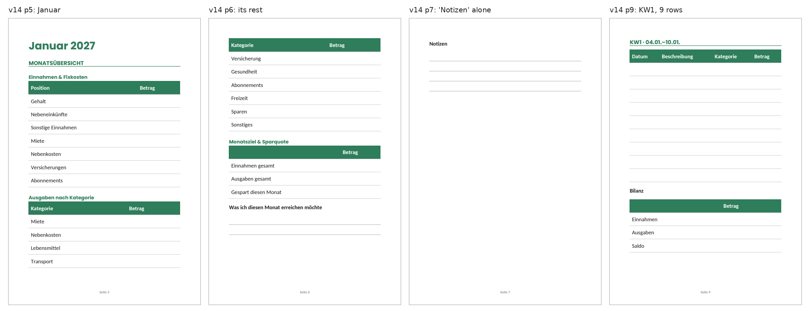
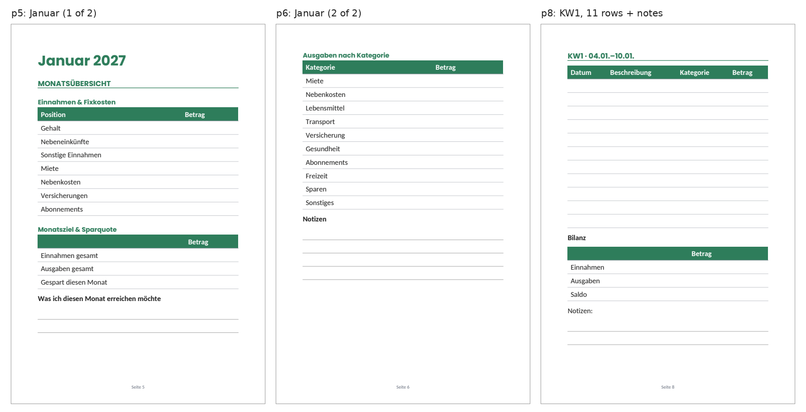

# Ember 0.39.1: what the evening diagnostics of 2026-10-14 show

*Your diagnostics report of 2026-10-14 18:36 UTC (version 0.39.1; cycles #272 to #283 in full), read against
`cb64642`, the head of the tracked branch, which is the 0.39.1 you run. Cycles #272 to #280 were in the morning's
report (`analysis-0.38.0`). This analysis is about the three since: #281 (12:22, the last under 0.38.0), and #282 and
#283 (20:00 and 20:33), the first two under 0.39.1. Nothing in the app changes with this report.*

**Evidence.** I read the whole report (6,943 lines):
- the three new cycles, with every call, reply and tool (80 tool calls);
- the planner's context as the next plan would see it, and the plan tree's ranking and waits;
- the records, the lessons file and the workspace's files with their times;
- the events since your rejection of request #109 at 12:17.

I checked every finding against the code. Labels, as in the earlier analyses:
- **live**: it is in your report.
- **code**: found by reading the code.
- **reproduced**: I ran Ember's own code on it. Here: I rendered the book's v13 (taken from the report, which cuts it
  after week 34), the v14 that cycle #282's workshop made from it (its task says exactly what it changed), and a layout
  that fits, with 0.39.1's `products/markup.py`, `products/pdf.py` and `products/images.py`.

**Paths** are relative to `ember/app/`. **Times** are Berlin time unless they say UTC.

---

## 1. The short answer

- **0.39.1 does what it was made for** (3.5):
  - no message was attempted after 20:00. STATUS lists today's messages #189 and #190, and OBLIGATIONS says "You told
    your owner in message #189". The morning had 14 refused message calls;
  - line #9's steps #182 and #183, which no cycle could do, were dropped at 20:00;
  - the review's stop on line #10 is now your decision, #189 on the Plan tab;
  - "The critic passes it" weighs 1.0 to 1.2, at the bottom of the ranking. It was 4.0 and on top;
  - no brainstorm comes before 10-21;
  - a refusal says how much to cut, and the agent cut it on the next try.
- **The book's v14 is a step back, and 0.39.1 doesn't say so** (3.1, 3.2, reproduced).
  - Cycle #282 judged 0.39.1's tables by pictures made on 10-12 by the old renderer. It took their 2 mm rows for
    today's and raised the line height to 1.9. Without it, an empty row is already 8 mm tall.
  - At line height 1.9 a week page holds 9 rows and no notes. At the normal line height it holds 11 rows and 2 note
    lines, or 10 rows and 4.
  - Each month overview of v14 takes three pages, the third holding only "Notizen". 0.39.1's book check warns only for
    a part that runs on to exactly one more page. So in the 34 weeks the report holds, v13 gets warnings for 42 pages,
    and v14 gets none.
- **Nothing reached you from the evening's $0.95** (3.3, 3.4).
  - #282 asked `make_document` for v14 in `books/`, but the workshop had kept it in `workshop/out/`. Its 8 looks were
    spent and its conversation full: the cycle ended without seeing a page of v14.
  - #283 made pin pictures for a step (#157) that needs a marketing cycle. It closed the step with the reason
    "placeholder" and added a new one (#190) for the next cycle.
- **The day's money**: $6.66 of $7 by 20:36, in 23 cycles. Nothing ran from 12:24 to 20:00, because the rest was kept
  for event wake-ups. That is the design (3.6).
- **The business is where it was at noon**: 17 views, $0 revenue, $105.70 left, 15.5 days of runway.

---

## 2. Where the business stands: live

| | Now (20:36) | At 12:17 |
|---|---|---|
| Etsy | 7 listings, 15 views in all, 0 favorites, 0 orders | the same |
| Printify | 2 posters, 1 view each, 0 orders | the same |
| Pinterest | pin #105 went out at 20:16; #117 waits for Friday 11:43 | #101 out at 11:15 |
| Bluesky | 21 posts, 49 reactions (2.3 a post), 143 followers | 47 reactions, 138 followers |
| KDP | Haushaltsbuch 2027: v14 made, not rendered, not proposed | rejected for the fifth time (#109) |
| Money | $105.70 left of $200: $93.70 API, $0.60 Etsy fees, $0 revenue | $107.07 left |
| Spending | $47.71 in the last 7 days; today $6.66 of $7 | today $5.29 by 10:01 |

---

## 3. Findings

### 3.1 The sixth Haushaltsbuch was judged by pictures of the old renderer: live, code, reproduced

**What happened.**
- At 12:22 your rejection woke cycle #281, still under 0.38.0. It found the cause the morning's analysis found: empty
  cells "collapse to near-zero row height regardless of line_height/row count". It used its 4 `make_document` calls on
  tests before it had a fix ($0.42).
- Cycle #282 (20:00) was the first on the book under 0.39.1. Its plan was right: "Version 0.39.1 now fixes that
  bug: empty rows render about 8 mm tall … Make the full book once with make_document at KDP 6x9, pages='6, 7, 30,
  83' … Inspect each image myself."
- The work step didn't make the book first. It looked at `books/check-kw-page6.png`, `-page5.png` and `-page83.png`.
  The workspace lists them as made on 10-12 at 22:39 and 22:40 UTC, two days before 0.39.1. They show the 2.2 mm rows
  of the morning's analysis (its 3.1).
- It read the documents guide: "a row with no words one line (about 7 to 8 mm)". The picture disagreed, and it
  believed the picture: "The current layout already should produce ~7-8mm rows. The owner complaint … maybe meaning
  rows are too close together". Then: "the rows in page6 are visually about 4-5mm tall … The line_height setting isn't
  set".
- It never rendered v13 as it was. Each test set `line_height: 1.9` and was compared with the old picture:
  "Excellent — this is a huge improvement!" Most of it was 0.39.1's: an empty row went from 2.2 mm to 8.15 mm with
  0.39.1, and to 10.6 mm with the line height.
- Its three test renders (14 rows, then 8 and 9, then 11 and 12) each got 0.39.1's warning, rightly: at 1.9 a page
  holds fewer rows. It settled on 9 rows and dropped the weekly notes.
- The workshop made v14 from v13 that way: line height 1.9 for the whole book, 9 rows a week, no "Notizen" under a
  week.

**What a page holds** (reproduced). An empty row is one line plus 2.2 mm of padding (`products/pdf.py:609`).

| A week on one 6x9 page at 12.5 pt | Row | No notes | 2 note lines | 4 note lines |
|---|---|---|---|---|
| normal line height (1.35) | 8.15 mm | 15 rows | 11 rows | 10 rows |
| line height 1.9 (v14) | 10.6 mm | 10 rows | 7 rows | 6 rows |

**What 0.39.1 says of v13 itself** (reproduced). Rendered as it was, v13 gets two warnings:
- "a page to fill in … runs on to a second page from pages 5, 7, 9, 11, 13, 15 and 36 more". That is every week and
  every month overview of the 34 weeks the report holds;
- "a table to fill in runs on to the next page from page 3": the year's plan.

Both point at the number of rows, not at the line height.

**Why the agent couldn't tell.**
- `look` names a picture and its size, not when it was made (`agent/tools.py:3897-3905`).
- 0.39.1 removes old pictures of a document when the document is made again. These have names of the agent's own
  (`check-kw-…`), so they stayed.
- The release notes said that rows are now one line tall. Nothing said that pictures made before show the old rows.
- The agent's lesson from 12:22 (cycle #281, still 0.38.0) says empty cells "collapse to near-zero row height
  regardless of line_height/row count". That was true of 0.38.0 and is false now.
  - It is still in the lessons file.
  - Ember's code marks a lesson for a re-check when a release changes a tool the lesson names. At 20:00 it marked
    "make_document is capped at 4 calls/cycle". This lesson names no tool.

### 3.2 0.39.1's book check misses a part that takes three pages: code, reproduced

**What 0.39.1 checks.** In a book, it names a part between two pagebreaks that runs on to a second page, if the part
holds a table with an empty row or writing lines (`products/pdf.py:350-353`). I left out a part that takes three pages
or more, for a notebook's pages of lines, which are meant to run on. That leaves out too much.

**What it misses in v14.**
- A month overview holds three tables of labels with empty amounts (Gehalt, Miete, …) and two sets of writing lines.
  At line height 1.9 it takes three pages. The third holds only "Notizen" and its lines.
- The year's plan takes three pages too.
- In my rendering of the 34 weeks the report holds, the year's plan and all 8 month overviews take three pages each.
  The other four months are built the same way.
- A table of labels isn't "a table to fill in" for the check: `_blank_rows` (`pdf.py:801`) wants a row whose cells are
  all empty. So "Ausgaben nach Kategorie", which breaks between pages 5 and 6, isn't named either.
- So v13 gets 42 pages named and v14 none. Yet v14's month pages show what you rejected in #81: "now tables spill over
  to the next page".

*v14 as 0.39.1 renders it: January's overview runs from page 5 to page 7, which holds only "Notizen". The week (page
9) has 9 rows at line height 1.9 and no notes. make_document reports no warning.*

**What fits** (reproduced): v13 at the normal line height, with
- each week: 11 rows, the Bilanz and 2 note lines (or 10 rows and 4 lines, as v13 had);
- each month overview: a pagebreak after "Was ich diesen Monat erreichen möchte". The first page holds the income,
  the month's goal and the plans; the second "Ausgaben nach Kategorie" and the notes;
- the year: pagebreaks before "Finanzielle Jahresziele 2027" and "Größte geplante Ausgaben 2027".

That is 54 parts on 54 pages for the 34 weeks, with no warning.

*The layout that fits: January's overview on two full pages, and a week of 11 rows with the Bilanz and two note lines
on one page.*

### 3.3 v14 in workshop/out, and a cycle out of room: live, code

- The workshop's task said "write the result to books/haushaltsbuch-2027-interior-v14.md". The workshop keeps what it
  makes in `workshop/out/`.
  - Its helper answered "Files exported: haushaltsbuch-2027-interior-v14.md".
  - Only the line after it said "Kept: workshop/out/haushaltsbuch-2027-interior-v14.md" (`agent/workshop.py:440-448`).
- `make_document` was asked for `books/…-v14.md` and refused: "doesn't exist". The refusal doesn't say that a file of
  that name is in `workshop/out/`.
- By then the cycle had used its 8 looks: 3 on the old pictures, 5 on test pages (`agent/tools.py:877`). With the
  right path it could not have looked at one page of v14, and its plan said not to propose a book it hadn't seen.
- The work conversation then passed its 64,000 bytes (`agent/loop.py:114`, `:1814`; the pictures count too) at tool
  step 17 of 20, and the cycle ended. It cost $0.50, $0.10 of it the workshop.
- The next cycle on line #6 is told to copy the file and picture pages 6, 7, 30 and 83. Those were KW1, the KW1/KW2
  turn, mid-year and KW52 in v13. In v14 the pages moved:
  - page 6 is January's second overview page;
  - pages 7 and 30 are lone "Notizen" pages.

  Under 0.39.1 v14 gets no warning, so those pictures are the only sign.

### 3.4 Pin pictures in a cycle that can't pin, and a step closed with "placeholder": live, code

**What happened.**
- Step #157, "Resubmit DE+EN pins with portrait images, same words, replacing #101/#102", was added by the agent as a
  step of kind "ship".
  - Only a step of kind "market" goes to a marketing cycle, the one that has `propose_pin`.
  - Cycle #275's journal had noted that #157 needed a marketing cycle (citing case #c268), and #282's plan said so
    too. #283's plan didn't.
- Cycle #283 (20:33) made the two pictures twice: first in the shape "portrait" (2000 × 2500), then "pin"
  (2000 × 3000). It tried `request_approval`, which was refused: "a pin goes through propose_pin (a marketing cycle's
  tool)".
- Then it closed #157 with `plan_step` done and the reason "placeholder".
  - 0.39.1 made that call possible: without `step_id` it means YOUR STEP. Until then it was refused for naming no
    step.
  - Its next reply: "I marked the step done prematurely".
- It then added #190, of kind "market": "propose_pin: pin_haushaltsbuch_de_v2.png + pin_budget_planner_en_v2.png ->
  listing 4584938666". The next cycle is a marketing cycle on it (weight 8.0).
- The cycle cost $0.45 for two pictures.

**Why.**
- `plan_step`'s `kind` has no description (`agent/tools.py:448`): nothing tells the agent that it decides which
  cycle takes the step.
- A done takes any reason (`agent/plan.py:3394`).

**The pins themselves.** #101 (out since 11:15, 0 impressions) and #117 (queued for Friday) are pins of the same
listing. A listing gets one pin in 2 days, so #190's two would go out about 10-18 and 10-20.

### 3.5 0.39.1 at work: live

- **Messages.** STATUS: "Your messages today that answer none of your owner's: 2 of 2 (#189 at 00:38 …; #190 at
  03:50 …)". The first tests #15 and #16: "You told your owner in message #189: work toward it; nothing more to tell
  them about it until it changes". #282 and #283 tried no message.
- **Channel line.** At 20:00: "Plan tree: line #9 is a channel: its steps #182, #183 for pins and posts of its own
  dropped".
- **The review's stop.** "line #10 has a review's stop … your owner decides on it": step #189, "You decide: keep line
  #10 or drop it", waits for you. TODAY'S REVIEW now says "a stop is your owner's decision (only they close a line)".
- **The critic.** Its four ready steps weigh 1.0 to 1.2 (kind 0.5, no urgency). Its three checks since your photo
  approvals at 12:15 scored 6, 5 and 5: still no pass, and no longer on top.
- **Brainstorm.** Step #181 was dropped: "the last brainstorm's 6 ideas (2026-10-14) had no research: the next
  brainstorm comes on 2026-10-21".
- **Refusals** say how much to cut: `make_image`'s badge "(cut 3)", a step's title "(cut 18)". Each was fixed on the
  next try.
- **The book warnings** fired on each of #282's three test renders and were right each time (3.1).
- **Not seen yet**: a venture cycle under 0.39.1, which would triage both waiting ideas (#34, #35) at once or make
  them wait.

### 3.6 The day's money: live, code

- By 12:24, 21 cycles since midnight had spent $5.71.
- Until 20:00 a fifth of the cap ($1.40) is kept for event wake-ups, so a scheduled cycle could take the day only to
  $5.60 (`economy/metering.py:109-110`, `agent/service.py:438-443`). Nothing ran from 12:24 to 20:00, and no decision
  of yours came to wake Ember. This is the design; the morning's analysis (its 3.9) described it.
- 0.39.1 started at 17:22. Its first cycle ran at 20:00 with $1.27. #282 and #283 left $0.34.
- #283 asked for 10 hours of sleep, got the most allowed, 6, and Ember's code cut it to 30 minutes: "your plan has
  steps ready". The 21:06 wake runs a cycle only if $0.34 pays for one (`agent/service.py:444-447`). Otherwise Ember
  waits for midnight.
- The three new cycles cost $0.42, $0.50 and $0.45: book and picture work. The morning's cycles #269 to #280 cost
  $0.16 to $0.29 each.

---

## 4. What you should do now

1. **Tell Ember before its next book cycle** (step #188, after the marketing cycle for #190). Something like:

   > The pictures books/check-kw-page5/6/6b/83.png are from before 0.39.1 and show the old 2 mm rows: delete them.
   > Since 0.39.1 an empty row is 8 mm tall at the normal line height, so drop line_height 1.9 and start again from
   > v13. A week: 11 rows, the Bilanz and 2 note lines. A month overview: a pagebreak after "Was ich diesen Monat
   > erreichen möchte". The year: pagebreaks before "Finanzielle Jahresziele" and "Größte geplante Ausgaben".
   > make_document must report no warning; then look at one week, a month's two pages and the year.

   Or wait for the code fixes 5.1 and 5.2.
2. **Delete lesson #c281 "KDP table bug found …"**, or tell Ember it no longer holds. It describes 0.38.0's renderer.
3. **Your decisions on the Plan tab**: #189 (keep or drop line #10), and #175 to #179 (lines #3 to #7, day 14).
4. **Optional:** when the marketing cycle proposes #190's two pins, you may decline them. They would be the fourth and
   fifth pin of the Haushaltsbuch listing, while #101 has no impressions yet. The queue could carry other listings'
   pins instead.

---

## 5. What I recommend for the code

In order of what they save you.

1. **The book check** (3.2):
   - name a part to fill in that runs past its page however many pages it takes, unless all it holds after its first
     page is writing lines (a notebook);
   - count a table whose rows each have an empty cell as one to fill in, so that a month overview's table that breaks
     is named;
   - the documents and KDP guides say what a week page holds with its total and notes (about 10 rows at 6x9 and
     12.5 pt with 4 note lines), and that a larger line height makes each row to fill in taller, so fewer fit.
2. **Old pictures** (3.1): `look` says when a picture was made. One made before the running version started says so:
   "made 10-12, before Ember 0.39.1: make it again to see it as it is now".
3. **A file in another place** (3.3):
   - a refusal for a missing file names a file of the same name elsewhere in the workspace, such as
     `workshop/out/haushaltsbuch-2027-interior-v14.md`;
   - when a workshop task names another place for a file, the workshop's result says first where it kept it.
4. **A step's kind** (3.4): `plan_step`'s `kind` says "market: a pin, post or blog post (a marketing cycle's)", and
   `request_approval`'s refusal of a pin says to add such a step. The fixed part of a work step has 13 bytes left
   under `test_rule_audit`'s bound, so the words need room made elsewhere.
5. **A done says what was done** (3.4): `plan_step` done refuses a reason of one word.

I can make these as 0.39.2. 5.1 and 5.2 would have changed this evening the most.

---

## 6. How I checked

- **The book.**
  - I took `books/haushaltsbuch-2027-interior-v13.md` from the report, which cuts it after week 34.
  - I made v14 from it as the workshop's task says: `line_height: 1.9` after `size: 12.5`, 9 of each week's 18 rows,
    and each week's "Notizen:" with its lines removed.
  - The layout that fits is v13 at the normal line height with 11 rows and 2 note lines a week and the pagebreaks
    of 3.2.
  - I rendered each with the repository's `products/markup.py` and `products/pdf.py` at 0.39.1, with the versions
    pinned in `requirements.txt`. I read each page's text with pypdfium2 to see what it holds, and drew the pages
    shown with `products/images.py` at 90 dpi.
  - The rows-per-page table renders one week page (heading, log, Bilanz, note lines) with more and more rows, and
    keeps the most that stay on one page.
- **The cycles.** Every cost, refusal and sleep is from the report's calls, tools and events. Cycle #282's are tool
  calls #4523 to #4546, #283's #4547 to #4575, #281's #4496 to #4522.
- **The code** is at `cb64642`, and line numbers are at that commit.
