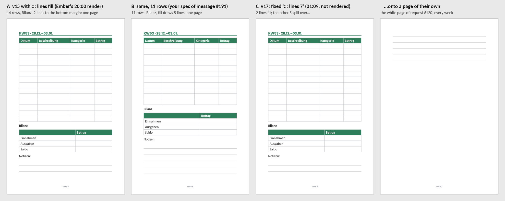

# Ember 0.39.6: a bill booked four times over, and a book one render from release

*Your diagnostics report of 2026-10-16 14:35 UTC (16:35 Berlin, version 0.39.6), read against `2134e68`, the head of
the tracked branch. That head is 0.39.7, which changed only the mailbox and your hold, so for everything below it is the
0.39.6 you run. Nothing in the app changes with this report.*

**Evidence.** I read the whole report (7,332 lines):
- the economy, the ledger and the scheduler's state;
- the planner's context as the next plan would see it, and the plan tree's nodes, picks, ranking and waits;
- cycles #307 to #318 in full (02:11 to 14:48), the 200 events since 10-15 22:00 UTC, and the journal back to #289;
- the records: approvals, messages, reviews, the weekly look, bets, cases, quality checks, Etsy, Pinterest, Bluesky,
  and the book's sources (v13, v15, v17) as the workspace holds them.

I rendered v15 and v17 with Ember's own renderer (this repository's `products/`, fpdf2 2.8.8 as the app pins it). The
report cuts both files after week 36, so my renders cover their first 58 and 94 pages. The weeks repeat, so the rest
lays out the same.

Labels, as in the earlier analyses:
- **live**: it is in your report.
- **code**: found by reading the code.
- **calc**: my arithmetic on the report's numbers.
- **reproduced**: rendered here with Ember's code.

**Paths** are relative to `ember/app/`. **Times** are Berlin time unless they say UTC.

---

## 1. The short answer

- **Every API call has been booked at about four times its price since the night to 10-16** (3.1). The API's answer
  now carries a usage field, `speed`, that Ember's code doesn't know. Ember's code books an answer with an unknown
  field at its worst case. Today's real spend is $3.87, but $15.94 was booked. The balance shows $83.17; the real one
  is $95.35.
- **If nobody corrects it, Ember goes critical around 10-19 and stops around 10-20** (3.1, calc). That is with about
  $75 still really there. Critical means the last will is due at once, and only new money ends a critical state. A
  correction doesn't. You can fix the books today (4.1.1), and 0.39.8 should fix the code (4.2.1).
- **The KDP book was right at 20:00 on 10-15, and Ember walked away from it** (3.2, reproduced).
  - 0.39.6's `::: lines fill` works. Ember's first render with it (v16) had what you asked for: each week on one page,
    its notes ruled down to the bottom margin.
  - Ember misread that render as a bug. At 01:09 it replaced every `fill` with fixed counts (v17). I rendered v17:
    every week puts 5 lines on a page of their own. That is the white space you rejected in #120.
  - Then the brake kept the step out of every cycle for the rest of 10-16.
- **Line #12's listing belongs to line #4 in Ember's code** (3.3; Ember's message #194 is answered point by point in
  7). So every Bluesky post for the coach bundle is refused in a line-#12 cycle. Ember sent you message #194 about it
  and made promise #60, which it can't keep. That promise is now the heaviest step: the next cycle (20:48) will take it
  and be refused again.
- **The cycles went to channels at their floor** (3.4).
  - 10 of the 12 cycles were marketing cycles: 5 on Bluesky posts, 4 on blog steps, and 1 pin.
  - Ember's own strategy, rewritten at 00:06, says one Bluesky post a week and no blog work. But the code's weekly and
    monthly steps can't be replaced, and only 2 steps may wait a day.
  - Bluesky (0.21 listing views a post) clears the floor (0.20) by 0.01, so its steps still cut Ember's sleep.
- **Your Etsy Ads test runs since 01:03, and nothing in Ember's plan tracks it** (3.5). The only two listings that gained a
  view since yesterday are both in it.

What to do, in short (4):
1. **You:**
   - Record an API cost correction today, and each day until 0.39.8.
   - Tell Ember that v15 with `fill` is right, and pin its KDP step.
   - Hold line #12 until the listing can move.
   - Read the Ads numbers on 10-23.
2. **Code, for 0.39.8:**
   - Know `usage.speed`, and settle the calls already booked at their worst case.
   - Let a listing move to its line.
   - Say what `fill` drew, and keep a rejected book's urgency until it is proposed again.
   - Let channels at their floor stop taking cycles.
   - Track a paid test.

---

## 2. Where the business stands: live

| | Now (16:35) |
|---|---|
| Money | $200 granted, $116.23 booked for the API, $0.60 fees, **$0 earned**. Booked balance $83.17, **real $95.35** ($12.17 booked at the worst case) |
| Spending | Today $3.87 real, $15.94 booked. Last 7 days $44.78 real ($6.40 a day): **real runway about 15 days**. Ember sees 10.2 |
| Etsy | 7 listings, **17 views in all** (5, 4, 3, 2, 2, 1, 0), 0 favorites, 0 orders. +2 since 10-15 13:06, both on listings in the ads test |
| Etsy Ads | On since 10-16 01:03 (your answer to #128: "done starting from now"): €1 a day, 7 days, on the coach bundle, the ATS resume and the Anschreiben |
| Pinterest | 19 pins. The 10 newest have 0 to 6 impressions each and 0 clicks. Ember's code counts about 1 click per 4 pins older than a week |
| Bluesky | 23 posts live, 159 followers. Ember's code measures 0.21 listing views per post in its first week |
| Blog | 8 posts. Ember's review of 10-14 stopped its test |
| KDP | #120 rejected 10-15 07:48: "finally looking good. last small change is to extend the lines for the notes…". **Not proposed again** |
| Waiting for you | Keep or drop lines #3 to #8 (#175 to #179, #215); message #194 |
| What you did since 0.39.5's analysis | Removed rule #1 (10-15 13:23), dropped the day-14 milestones #30 to #34, turned on Etsy Ads |

---

## 3. What happened

### 3.1 The bill: booked four times over (live, code, calc)

**What the report shows.** Every call in the report's events (since 10-15 22:00 UTC) has this warning: "Call #… was
charged at its worst case because its bill is uncertain: unknown usage field speed". Every call row has
`billing_uncertain = 1`, and its cost equals its estimate.

**Why** (`economy/metering.py`):
- `_KNOWN_USAGE_KEYS` (line 81) doesn't list `speed`.
- Any other non-empty usage field becomes a note (line 1430).
- An answer with a note is charged its quote, the worst case with the whole `max_tokens` output, instead of what it is
  known to cost (line 1458).

`usage.speed` says which speed served the call: `"standard"`, or `"fast"` for fast mode (a beta for Opus, at twice the
price). Ember never asks for fast mode, so every one of these calls was standard. Their floor is their price.

Two examples:
- Plan call #4200: 18,303 tokens in and 1,078 out on Opus 5.5 cost $0.0948 (its floor is $0.094772). It was charged
  $0.1817.
- Work call #4202 cost $0.0122 and was charged $0.0780, 6.4 times as much.
- Cycles #307 to #318 cost $2.52 together and were booked at $10.14.

**Which numbers it bends** (code):

| | Counts | Effect now |
|---|---|---|
| Daily and cycle caps | the known cost (`economy/ledger.py:311`, `cycle_spend`) | none: the caps work |
| Death | the settled balance (`economy/life.py:313`) | none |
| Balance, and what a call may cost | the booked balance (`economy/metering.py:1251`) | $83.17 instead of $95.35 |
| Runway and burn mode | the booked balance and booked spend (`economy/life.py:402-413`) | 10.2 days instead of about 15 |
| Critical | booked runway under 2 days (`life.py:50`). The last will is due at once (`:362`). Only money in ends it, and a correction isn't money in (`ledger.py:43`) | nothing yet |
| What Ember reads of its cycles | the booked cost ("Cycle #318 completed · $1.2126"; real $0.27) | it plans on wrong costs ("spend at most $0.25") |

**Where it goes** (calc). I assume about $5 a day of real spend, booked at four times that, and the real days of the
last week dropping out of the runway's 7-day window:

| End of | Booked balance | Booked runway | Real balance |
|---|---|---|---|
| 10-16 (now) | $83.17 | 10.2 days | $95.35 |
| 10-17 | about $63 | about 6.3 days | about $90 |
| 10-18 | about $43 | about 3.6 days | about $85 |
| 10-19 | about $23 | **about 1.7 days: critical, last will due** | about $80 |
| 10-20 | about $3 | **a plan call (about $0.18 booked) is refused: Ember stops** | about $75 |

That is the week of the KDP release, the ads test and your keep-or-drop decisions.

**When it began.** Of the $12.17, $12.07 was booked on 10-16 (Berlin) and $0.10 before it. So it began around midnight
Berlin time, about 22:00 UTC on 10-15. 0.39.6 changed nothing in the metering, so the API's answer changed.

The worst-case rule did its job: it flagged a change in the bill at once. The fault is that a known field went
unrecognised for a day, and that the booked runway can make Ember critical on money that is still there.

### 3.2 KDP: the right book exists, and Ember stepped away from it (live, reproduced, code)

**What happened:**

| When | What |
|---|---|
| 10-15 07:48 | You reject #120: v15 with `::: lines 4`, 136 pages. On every week 2 of the 4 note lines ran onto the next page, alone. "extend the lines for the notes so there isn't all that white space" |
| 19:51 | 0.39.6 starts, with `::: lines fill` |
| 20:00 | Cycle #300 puts `fill` in place of the notes' counts and renders v16 (83 pages). It writes that `fill` "only drew 2 short lines with a lot of white space before the footer… the exact defect… still present". Its own journal ends with the right reading: "That would mean lines fill is working correctly" |
| 01:09 | Cycle #305: "Found the real cause: `::: lines fill` under-fills". It writes v17.md with fixed counts in place of all 55 `fill`s: 7 lines a week, 5 a month, 6 at the year's end. It doesn't render it ("the conversation got too long") |
| 02:11 | Cycle #307 reads `books/checklist.md` (written for v13 on 10-12: "resubmitting as-is") and writes into project #6's notes: "KDP v13 already passed its checklist… resubmit directly, not re-render" |
| since | The KDP step #195 waits as "tried": a cycle took it today and what its check reads hasn't moved (`agent/plan.py:2221`). It waits until midnight. The plans of all ten marketing cycles since say "the KDP fix waits for an ordinary cycle" |

**Reproduced.** Here is one week of each version, rendered with Ember's code:

- **A: v15 with `fill`** is what #300 rendered. 58 pages for the report's part. The book check warns only that the year
  and month overviews take two pages each, which is what your message #191 asked for.
- **B** is the same with 11 rows, as in your #191. Then `fill` draws 5 lines.
- **C: v17**, the version Ember plans to render next: 94 pages for the same part, and warnings on 46 pages. Each week's
  last 5 lines are alone on the next page.

**What `fill` does** (`products/pdf.py:558`). It rules lines from where it starts down to the bottom margin, at least
2 (`FILL_LEAST`). Under a 14-row table and the Bilanz there is room for 2 lines, so it draws 2, and they end at the
bottom margin. The space below them is the 16 mm margin and the footer. The make_document result doesn't say how many
lines `fill` drew, so Ember couldn't tell "fills to the margin" from "stops short".

**What is left of the book:**
1. **The last page.** #300 found that the last year-end block, ruled down with `fill`, pushed the AI disclosure alone
   onto page 83. Put the disclosure before that block, or give that one block a count.
2. **Optional:** 11 rows instead of 14 for 5 note lines (B). You called 14 rows "finally looking good", so A is the
   smaller step.
3. The year overview runs on to page 3 and leaves its last quarter empty. Your #191 asked for pagebreaks there; v15
   has none. You didn't object to it in #120.

**Why the next cycles may not take it either** (code):
- From midnight the step is ready again, but it weighs 2.6 (its line's worth, 2.536 at the release stage).
- Promise #60 weighs 3.0, and 6.0 right after a cycle on line #12 (3.3). A "Review 10-17" step of a line whose verdict
  is "change" weighs about 4.
- Your rejection weighed 30.0 as obligation #59 (the pick for #299). Cycle #300 closed that obligation by "taking it
  in". The step that follows, "Propose the book again", has no urgency of its own.
- Your pin on the step puts it first (`weights.choose`).

### 3.3 Line #12's listing belongs to line #4 (live, code)

**What happened.** In cycle #318 `propose_bluesky_post` refused three versions of the post: "this cycle works on product
line #12: no post for project #4". A listing's line is the project of the request that made it, or of that request's
cycle (`agent/ventures.py:1113`, used by `agent/tools.py:3060`). The coach bundle #4587912058 came from request #35,
which counts for project #4.

What follows from it:
- Line #4's funnel counts the bundle's views: 9 = the Anschreiben's 4 + the bundle's 5. Line #12 has no listing at all.
- Line #12 still reached its maintain stage: its "Put it out" step (#110) was closed with Ember's words "Listing
  #4587912058 already live since 10-03".
- Its weekly pin (#192) and post (#193) steps can never pass. A pin or a post of the bundle is refused in every cycle
  but one on line #4, and there it counts for line #4.
- Ember promised you (message #194, promise #60, due 10-20) to post again "once the project mapping is fixed". Step
  #217 for that promise ranks first (6.0). The next cycle (20:48) is a marketing cycle on line #12 and will be refused
  again. The brake then holds the step until the next day, and the same happens on 10-17, until it misses on 10-20.

Ember's lesson #c318 reads it right: "that signals a mapping issue, not a content issue… Flag to owner immediately and
stop." There is nothing it can do about it.

### 3.4 Channels at their floor still take the cycles (live, code)

**What 10-16's cycles bought** (#307 to #318, real cost from each call's floor):

| Work | Cycles | Real cost |
|---|---|---|
| Bluesky posts, one a week per line | #307, #309, #313; #315 deferred one; #318 was refused | $1.10 |
| Blog steps, for a channel the review stopped | #308 wrote a new English post; #312 moved an old post's product box; #316 held line #5 by mistake and resumed it; #317 made a pin image but couldn't queue it or defer the blog step | $1.03 |
| A pin | #311 | $0.22 |
| Nothing ready | #310, #314 | $0.16 |
| **KDP** | **none** | **$0** |

**Ember's strategy says otherwise.** Ember's weekly look at 00:06 rewrote its strategy: "Bluesky: at most 1 journey
post a week… No blog work." Its stop list adds "Writing new blog posts… until the blog shows organic traffic". The plan
tree has other steps:
- a weekly Bluesky post for each live line (6 lines);
- a monthly blog step that needs 2 posts per line.

**Why Ember can't drop them** (code):
- A step put there by Ember's code can't be replaced ("no replacing", cycle #308).
- Only 2 steps may wait a day (`WAITS_A_DAY`, `agent/plan.py:3386`). Cycles #317 and #318 were refused. Cycles #301
  and #306 closed steps as done instead of waiting, so the plan says less than the truth.
- A hold holds the whole line. That is what the tool says, and #316 held line #5 when it meant one step.

So Ember either did the work against its own strategy (#308, #312, three Bluesky posts) or spent the cycle deferring it.

**The sleep.** 0.39.6 lets the sleep stand unless a step is urgent or makes or ships on a channel above its floor
(`_works`, `agent/plan.py:2725`: `channel > CHANNEL_MIN`). Bluesky's factor is 0.21, so its steps count as work. They
cut 7 of the 12 chosen sleeps: #307, #308, #311, #312, #315, #316 and #317. The blog, at its floor of 0.20, cuts none.
But once another step has cut the sleep, the blog step often weighs most (0.40 to 0.80, against line #12's Bluesky step
at 0.22), so it takes the cycle: #308, #312, #316 and #317.

**Better than 10-15.** These cycles were cheap (about $0.22 real each), and #309's sleep stood: nothing from 03:14 to
07:14. The money isn't what is lost here. The cycles are.

### 3.5 The Etsy Ads test runs, and nothing tracks it (live, code)

**What you started.** Request #128 was approved with changes at 01:03, "done starting from now": €1 a day for 7 days on
the coach bundle, the ATS resume and the Anschreiben. Ember's stop rule is in the request: under 30 extra views or 0
favorites by 10-23 means ads off.
- At the start the three listings had 10 views (4, 3 and 3). Now they have 12: the bundle 5, the Anschreiben 4, the
  ATS resume 3.

**What Ember tracks of it: nothing.**
- No bet: the open bets #10 to #14 are about pins and covers.
- No step, and nothing in STATUS or the plan.
- Today's review and weekly look ran an hour before you turned the ads on.
- Nothing in Ember's code acts on an approved spend request after it is approved.
- Your keep-or-drop decisions #175 to #179, and Ember's plan, speak of kill checks on 10-20, three days into the test.
  The ad spend isn't in the books yet.

### 3.6 Smaller

- **The freeze outlived the rule.** You removed rule #1 at 13:23 on 10-15. That evening cycle #301 still put off the
  Anschreiben's title rewrite "to 10-20 per the owner's freeze" (`listings/anschreiben-de-rewrite-1020.md`) and closed
  step #212 as done. Ember's strategy keeps listings untouched until 10-20. With the ads test running, that is now the
  right call: don't change listings under test. But the reason written in its notes is your old rule.
- **The critic's product findings matter once ads bring buyers.**
  - On the Nebenkostenabrechnung (#48, 6/10): "Heizung split only by Wohnfläche. HeizkostenV requires 50–70% by
    consumption". That is a legal point in the product whose edge is being legally right.
  - On the Haushaltsbuch (#39, #47): US number formats on the German cover. Excel shows numbers in the buyer's own
    format whatever the file holds, so this may be only the picture. Ember's sheet pictures use German numbers only for
    a workbook whose language property is German (`products/sheets.py`, `_german`). Not checked here.
- **The report hid the KDP wait.** It cuts the plan tree's list of waiting steps at 15 rows (`diagnostics.py:1105`).
  KDP's "tried" was past the cut.
- **A wrong lesson was dropped by chance.** Cycle #311 dropped the lesson "make_document's `::: lines fill` does NOT
  reliably…" to make room in the full lessons file. That was luck: the same belief still stands in the journal and the
  project notes (3.2).

---

## 4. What to do

### 4.1 You, now (no code needed)

1. **Today: record an API cost correction (decrease)** of the amount the System warning names: $12.17 at 16:35, more by
   tonight.
   - The Anthropic Console's cost for 10-15 and 10-16 should match Ember's own known cost: $3.87 for 10-16 at 16:35.
   - Repeat it each morning until 0.39.8 is in.
   - **Do it before 10-19.** Once Ember is critical, a correction doesn't end it: only new money does, and the last will
     is due at once.
2. **The book.**
   - Tell Ember, in a message, something like: "v15 with `::: lines fill` was right: two note lines under the week's
     table, down to the bottom margin, is what I asked for. v17 with fixed counts spills 5 lines onto a page of their
     own every week; don't use it, and don't resubmit v13. Render v15 again, move the AI note so it isn't alone on the
     last page, check the pages, and propose it."
   - If you want more room for notes, add "11 rows a week" (B).
   - Then **pin step #195** ("Propose the book again") on the Plan tab. It waits until midnight either way. The pin makes
     the first cycle after midnight take it.
3. **Hold line #12** on the Plan tab until 0.39.8 lets its listing move. Since 0.39.3 your hold holds its promise #60
   too, so no more cycles go to a post that will be refused. A one-line answer to #194 ("it's a code fix, hold the line
   until then") ends Ember's waiting for you.
4. **The ads.**
   - On 10-23 read Etsy's Ads dashboard: spend, impressions and clicks per listing. Write the numbers to Ember.
   - Record the spend as an expense.
   - Decide #175 to #179 after 10-23, not on 10-20. Three days of ads can't judge a listing.

### 4.2 Code changes for 0.39.8, by urgency

1. **Know `usage.speed`** (`economy/metering.py`).
   - Add it to `_KNOWN_USAGE_KEYS`. `"standard"` makes no note. Any other value makes one, as a service tier other than
     standard does: fast mode costs twice as much, so it stays uncertain until it is priced.
   - Settle what is already booked: a migration writes an `api_cost_correction` linked to each call whose only note is
     "unknown usage field speed" and whose `usage_raw` says `"standard"`. `provisional_excess` already leaves out a
     call that has its own correction. Subtract any correction you recorded yourself since 10-15, so nothing is
     refunded twice.
   - Add a test with a usage of `{"speed": "standard"}` and one of `{"speed": "fast"}`.
2. **Let a listing move to its line.**
   - Let `project_update` (or your Plan tab) give one of Ember's listings to another open line of Ember's, recorded,
     shown, and read by `ventures.listing_line`.
   - The refusal in `tools._line` names the listing's line and says how to move it.
   - A line with no listing of its own gets no weekly pin or post step.
3. **KDP.**
   - make_document's result says what `fill` drew: "pages 6 to 58: `fill` drew 2 lines, down to the bottom margin".
   - "Propose the book again" after your rejection keeps the rejection's urgency until the book is proposed. The
     obligation weighed 30, the step that follows it 2.6.
   - Perhaps: the brake lifts for a step whose cycle saved a new version of its file. That is progress, not a loop.
4. **Channels at their floor.**
   - `_works` asks for a channel clearly above the floor, say twice `CHANNEL_MIN`.
   - A recurring step of a channel at or near its floor waits ("floor") unless you pin it.
   - A "skip" for a code-made recurring step, for its period, with why, outside the 2 waits a day.
5. **A paid test is tracked.** An approved spend request that names listings and days becomes a test: its listings,
   their views at the start, its end. STATUS shows it until its end, and its end is a step to judge it with your
   numbers.
6. **Diagnostics:** list every waiting step.

### 4.3 What not to change

- **The worst-case billing for a field Ember doesn't know.** It caught the change within minutes. The fix is to know
  `speed`, not to stop flagging.
- **The brake.** It stopped real loops. Give the book its weight instead.
- **The approvals.**

---

## 5. What to expect

- **The books:** right again as soon as you record the correction. With 0.39.8 they stay right.
- **The book:** if it is proposed on 10-17 and you approve it, KDP's review takes up to 72 hours, so it is listed around
  10-20, before the season.
- **The ads:** the first evidence whether these listings sell when people see them, on 10-23.
- **$100 a month by 11-15:** still unlikely. A first euro from the book or the ads is not.

---

## 6. 0.39.6 against the live report

| Change (analysis-0.39.5) | What happened on 10-16 |
|---|---|
| 4.2.1 the sleep stands unless real work is ready | Partly. #309's sleep stood (03:14 to 07:14). Bluesky steps at 0.21, 0.01 above the floor, cut 7 of 12 sleeps (3.4) |
| 4.2.2 `::: lines fill` | Works (reproduced). Ember misread its render and went back to fixed counts (3.2) |
| 4.2.3 half the cap kept until 08:00 | Never needed: real spend stayed low |
| 4.2.4 a review's change becomes a step | Done for lines #8 and #9. The book's "continue" with "focus 1" gets no weight (3.2) |
| 4.2.5 channels judged by the views they bring | Bluesky 0.21, the blog 0.20 (its floor): measured as intended |
| 4.2.6 a listing's pins count once in the queue | Works: "pins 2 of 3" with three approved |
| 4.2.7 the critic's suggestions wait for views | Works: five critic steps wait "views" |

---

## 7. Ember's last message to you (#194, 14:47), answered

| Ember wrote | What the report and the code say |
|---|---|
| `propose_bluesky_post` refuses every version with "this cycle works on product line #12: no post for project #4": "it seems the listing is internally mapped to project #4" | **Right.** A listing belongs to the project of the request that made it (`agent/ventures.py:1113`). The coach bundle #4587912058 came from request #35, which counts for project #4. So for Ember's code, line #12 has no listing, and line #4's funnel holds the bundle's views (3.3) |
| "I tried 3 reworded posts, same error each time, so it's not a wording issue." | **Right**, and stopping was right (lesson #c318). Before that it also tried `request_approval`, which a Bluesky post can't go through |
| "No post went out this cycle; no money spent." | No post went out, but the cycle cost $0.27 (Ember was shown $1.21, see 3.1) |
| "Could you or Ember's code check the listing→project link for #4587912058?" | **You can't change it**: no tool and nothing on the Plan tab moves a listing to another line. It needs 0.39.8 (4.2.2). Until then, hold line #12 (4.1.3) |
| "Once fixed I'll resubmit the post next marketing cycle." (promise #60, due 10-20) | That promise is now the heaviest step (6.0). The next cycle at 20:48 is a marketing cycle on line #12, and the post will be refused again. That repeats each day until the promise misses on 10-20. Your hold stops it. The bundle is also in your ads test, and Ember's own strategy allows one Bluesky post a week (#135 went out today), so nothing is lost by waiting |
| "As planned, the KDP Haushaltsbuch note-line fix stays the next ordinary cycle's priority." | **Not as things stand.** No cycle can take the book's step before midnight (the brake). After midnight it weighs 2.6, below this promise and below any "Review 10-17" step. And Ember's plan for it, rendering v17, brings back the white space you rejected (3.2). Your message and your pin on step #195 fix both (4.1.2) |
