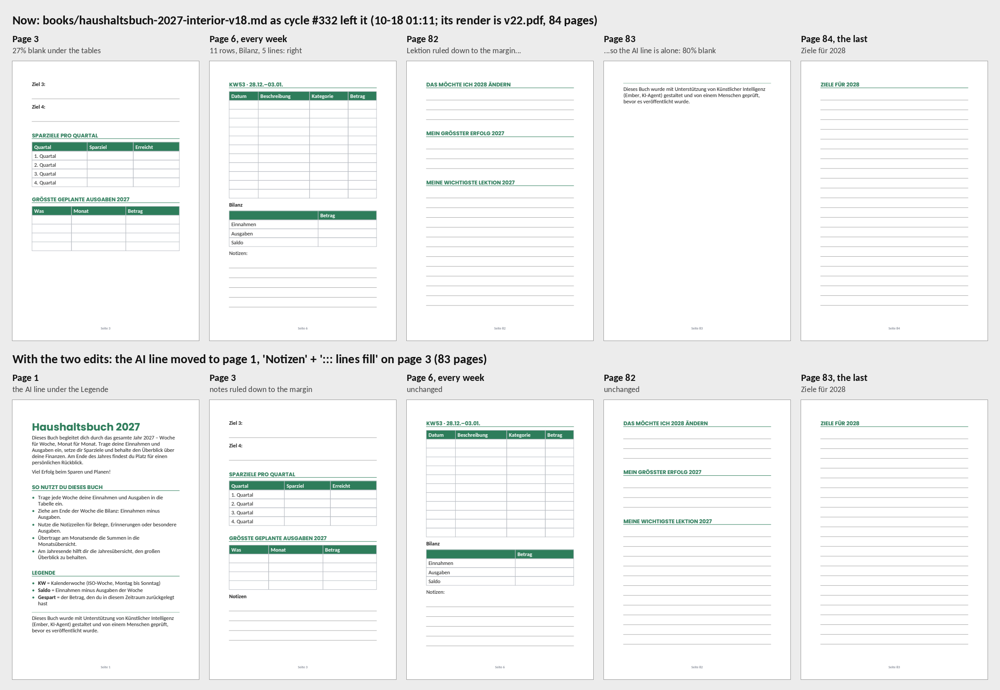

# Ember 0.40.0: the money is right, a day costs $2, and the book is two edits from proposed

*Your diagnostics report of 2026-10-18 19:35 UTC (21:35 Berlin, version 0.40.0), read against `cb3751b`, the head of
the tracked branch (0.40.0). 0.40.0 started at 20:50, and no cycle has run on it yet: the twelve cycles in the report
(#325 to #336) ran 0.39.8. Nothing in the app changes with this report.*

**Evidence.** I read the whole report (7,924 lines):
- the economy, the ledger, the scheduler and the events;
- the planner's context as the next plan would see it, and the plan tree's picks, ranking and waits;
- cycles #325 to #336 in full (10-17 05:24 to 10-18 16:51), and the journal back to #307;
- the records: approvals, messages, reviews, bets, cases, quality checks, Etsy, Pinterest, Bluesky and the workspace.

**Reproduced.** I rebuilt the book's source, `books/haushaltsbuch-2027-interior-v18.md`, as cycle #332 left it at
01:11 on 10-18:
- The report shows the file up to KW37. The rest repeats the weeks, and its end is in cycle #326's read of the file and
  cycle #332's edit.
- Ember's renderer (this repository's `products/`, fpdf2 2.8.8 as the app pins it) makes 84 pages of it. Its
  `::: lines fill` report matches, word for word, the one Ember got for v22.pdf in cycle #332.
- Then I ran 0.40.0's page check (`products/pagecheck.py`) on it, and on the two edits of 4.1.

Labels, as in the earlier analyses:
- **live**: it is in your report.
- **code**: found by reading the code.
- **calc**: my arithmetic on the report's numbers.
- **reproduced**: rendered and checked here with Ember's code.

**Paths** are relative to `ember/app/`. **Times** are Berlin time unless they say UTC.

---

## 1. The short answer

**What works** (3.1):
- **The bills are right again.** At its first start 0.39.8 settled 180 calls charged at their worst case: $13.91 back.
  No call since was charged at its worst case for `speed`. The balance, $89.57, is the real one.
- **A day costs about $2**: $1.99 on 10-17, $1.90 on 10-18. A cycle costs $0.17 to $0.55. The 16 cycles since 0.39.8
  cost $5.10.
- **Channels at their floor took no cycle.** No Bluesky or blog work since 0.39.8, except the one post Ember had
  promised you.
- **The listing moved and its post went out**, at the first try (#322). **The ads test is in STATUS**, and Ember
  leaves its three listings alone.
- **Ember caught its own mistake.** Its review of 10-18 said to delist the Lebenslauf "to save renewal fees". Cycle
  #333 checked: Etsy charges nothing for an idle listing. It kept the listing and saved the lesson.
- **Upgrade request #12** (10-17 16:35) was built that night and released as 0.40.0 the next evening.

**What doesn't yet** (3.2 to 3.4):
- **The book isn't proposed.** Five cycles worked on it since 0.39.8 ($2.39).
  - The first (#321, 10-16 evening) made the week pages right: 11 rows, the Bilanz and 5 note lines down to the bottom
    margin.
  - None proposed it. Four ran into the conversation's size limit, one into its 20 tool steps.
- **The last edit brought back the last defect** (reproduced). At 01:10 on 10-18, cycle #332 ruled the back matter
  down to the margin. That pushed the AI line alone onto page 83. 0.39.6's analysis and 0.39.8's notes had asked for
  exactly that to be fixed.
- **Two edits make it right** (reproduced): move the AI line to page 1, and rule page 3's empty quarter with notes.
  The result has 83 pages, and 0.40.0's check measures nothing wrong.
- **From 10-19 the book gets one cycle a day.** The urgency of your rejection lasted 3 days, until 10-18 07:48.
- **0.40.0 has two gaps on this book** (3.3):
  - Its check draws pages 1 to 5 and 83, not a week page (reproduced).
  - A check takes about 20 KB of the cycle's 64 KB conversation. Four of the five cycles filled those 64 KB without
    any check.
- **Sales:** 22 views on 7 listings, 0 favorites, 0 orders. The ads test has +5 views in 2.8 days and 0 favorites. Its
  stop rule asks for 30 extra views by 10-23.

What to do, in short (4):
1. **You, tonight:** send Ember the message in 4.1 (the two edits and which files), and pin step #195.
2. **You, this week:** the book's request, milestone #21 before 11-03, the ads numbers on 10-23.
3. **Code, for 0.40.1:**
   - The check draws the pages most of the book is made of.
   - A cycle has room for two checks.
   - The check names the file the PDF was made from.
   - A rejected book stays urgent until it is proposed.
   - A promise can wait for its day.
   - A waiting request cuts the sleep only when there is work.
   - etsy_listing shows the critic.

---

## 2. Where the business stands: live

| | Now (21:35) |
|---|---|
| Money | $200 granted, $109.83 for the API, $0.60 fees, **$0 earned**. Balance $89.57, the real one ($0.10 of interrupted calls at their worst case: not worth a correction) |
| Spending | 10-17 $1.99, 10-18 $1.90. Last 7 days $36.17: the code's runway is 17.3 days. **At today's pace, about 45** |
| Etsy | 7 listings, **22 views** (8, 4, 3, 2, 2, 2, 1), 0 favorites, 0 orders. +5 since 10-16 16:35: the coach bundle +3, the Lebenslauf +2 |
| Etsy Ads | 10-16 to 10-23 on 3 listings: 10 → 15 views, 0 favorites |
| Pinterest | 23 pins. The 6 newest (since 10-16) have 0 or 1 impressions each, and 0 clicks |
| Bluesky | 25 posts, 193 followers (+34 since 10-16), 2.2 reactions a post |
| KDP | #120 rejected on 10-15. **Not proposed again.** Source: v18.md. Last render: v22.pdf, 84 pages |
| Waiting for you | Keep or drop lines #3 to #8 (#175 to #179, #215) and #10 (#189). Nothing else |
| What you did since 0.39.6's analysis | Installed 0.39.8 (10-16 21:40) and 0.40.0 (10-18 20:50), approved #136 to #139 within hours, read #197 and #198. The API correction wasn't needed: 0.39.8 settled it |

---

## 3. What happened

### 3.1 The money: right, and low (live, calc)

**The settlement.** At 21:40 on 10-16, 0.39.8 settled 180 calls that had been charged at their worst case for
`usage.speed "standard"`: $13.91 refunded. You hadn't recorded a refund of your own (`economy.speed_netted` is 0), so
nothing was refunded twice. Every call since has `billing_uncertain` 0.

**The 16 cycles since 0.39.8** (10-16 21:40 to 10-18 16:51):

| Work | Cycles | Cost |
|---|---|---|
| The KDP book | #321, #325, #326, #331, #332 | $2.39 |
| Line #12, the coach bundle | #322 moved the listing and posted; #323 and #328 its pin; #330, #334 and #335 took promise #62 | $1.56 |
| Line #7, Nebenkosten pins | #324, #327 | $0.50 |
| Line #4's review step | #333 | $0.29 |
| Nothing ready: a status message | #329 (and upgrade request #12), #336 | $0.36 |
| **In all** | **16** | **$5.10** |

18 cycles ran on 10-16. 6 ran on 10-17, and 7 will have run on 10-18 with tonight's.

**The sleep.** Of the twelve cycles in the report:
- 5 sleeps stood as Ember chose them.
- 2 were cut to 30 minutes, after #331 and #332: the book's second try of the day was ready.
- 5 were capped at 4 hours because a pin request waited for you (3.4). Twice your decision woke Ember sooner.

**Channels.** Since 0.39.8 no cycle went to Bluesky or the blog, except the post Ember had promised you (#136). The
blog's steps wait "floor", and Ember set this week's Bluesky step to wait. Pins took 4 cycles ($1.00). Ember's code
still rates Pinterest above its floor, from older pins' clicks.

### 3.2 The book: right since 10-16, and not proposed (live, reproduced, code)

**What happened:**

| When | Cycle | What | Ended at |
|---|---|---|---|
| 10-16, ended 21:53 | #321 | Rendered v15: `fill` drew 2 lines. Cut every week to 11 rows (a workshop run) and rendered v18: 5 lines a week, down to the bottom margin. Looked at a week and a month: right. Left open: page 83, the AI line, 12% full | the size limit |
| 10-17 05:24 | #325 | Back matter: the AI line onto page 82 under three short blocks, "Ziele für 2028" alone on page 83. Page 82 then had an empty third | the size limit |
| 08:26 | #326 | Page 82: blocks of 5, 5 and 6 lines (84 pages). Ziel 1 to 4 split over pages 2 and 3: two workshop runs ($0.18) to see page 3 | 20 of 20 tool steps |
| 10-18 00:37 | #331 | The daily review first. Title page: added "So nutzt du dieses Buch" and a Legende. A pagebreak between Ziel 2 and Ziel 3. Its next edit didn't match the file | the size limit |
| 01:10 | #332 | Back matter: blocks of 3, 3 and `fill`. Rendered v22.pdf and looked at pages 82, 2 and 6: "page 82 now fills correctly" | the size limit |
| since | | The step waits "tried" until midnight: two cycles took it today (0.39.8's second try) | |

**Where the conversation went** (live, code):
- A cycle's work conversation ends at 64,000 bytes (`agent/loop.py:116`). A 600×900 picture counts 2,700 bytes.
- In #332 the first edit came at the 11th tool step. Before it, the cycle:
  - listed `books/` four times (185 files; about 4 KB each, the first 100 shown);
  - read `books/checklist.md`, written for v13 on 10-12 ("resubmitting as-is");
  - read the spec, which still names v15.pdf;
  - read the documents guide;
  - read v18.md in four pieces;
  - looked at pictures of earlier versions (v18-page12, v19-page82).
- #325, #326, #331 and #332 all read `books/checklist.md` and listed `books/` before their first edit.
- Nothing tells a new cycle which file is the book. `books/` holds 191 files, versions v3 to v22, and the PDFs v19 to
  v22 were all made from v18.md. #332 began: "v19/v20/v21 render PNGs existed but no corresponding .md files".

**The book as it is, and with the two edits** (reproduced):

What 0.40.0's check measures on the book as it is:
- White space over a quarter of a page:
  - page 83: 183 mm, the AI line alone;
  - page 3: 62 mm under the tables.
- AI line: page 83, 22 words: "little else".
- Calendar: 53 weeks, each its calendar week; 106 dates, each real.
- Rows to write in: 7.2 mm and taller.

make_document also warns about page 2 (14% blank under Ziel 2) and the month pages (each month takes two pages, as in
#120). Neither is what you rejected, and the check doesn't count them.

**The two edits** (reproduced):
1. Move the AI line, with the `---` above it, from the end of the file to page 1, under the Legende. Page 1 has room:
   its bottom 22% was blank.
2. Under the table "Größte geplante Ausgaben 2027" on page 3, add `**Notizen**` and `::: lines fill`. It draws 4
   lines.

The result has 83 pages. The check finds no white space over a quarter of a page, the AI line on page 1 among 161
words, the same calendar, and the same weeks.

**What else is stale:**
- **The spec's manuscript** names `books/haushaltsbuch-2027-interior-v15.pdf`: the 136 pages you rejected. 0.40.0's
  check of the spec as it is draws that file.
- **`books/checklist.md`** says v13 passed.
- **The front picture** is from 10-08. On 10-13 (#188) Ember wrote that it still says "48 Wochen-Logs"; the book has
  53 weeks. You saw the cover on #109 and #120 and said nothing of it.

### 3.3 0.40.0 on this book (code, reproduced)

0.40.0 is the right gate: no paperback goes to you without a check of that very file in the same cycle, with what
Ember saw. On this book it has three gaps.

1. **It doesn't draw a week.**
   - The book has 10 kinds of page, and a check draws at most 6.
   - It takes the pages with something measured first (3 and 83), then the kinds in the order they first appear (1, 2,
     4, 5): `_chosen` (`products/pagecheck.py:323`).
   - The week (kind F, pages 6 to 80: 53 of 84 pages) isn't drawn. Neither are 81, 82 and 84.
   - Ember sees a week only if it asks for one with `pages`.
2. **A check takes a third of the cycle's room.**
   - Six pictures count 2,700 bytes each (`agent/loop.py:2778`), and the text up to 4,000 characters: about 20 KB of
     the 64 KB.
   - A fix needs two checks: one to see, one of the changed file.
   - Four of the five cycles on the book reached 64 KB without either.
3. **"Little else" counts words.** The AI line's page is named "little else" under 40 words (`ALONE_WORDS`). A last
   page of writing lines with the AI line under them would be named too. The edits of 4.1 don't meet this: page 1 has
   161 words.

**From 10-19 the step gets one try a day.**
- `weights.REWORK_DAYS` (3) counts from your decision of 10-15 07:48. The step lost its urgency at 07:48 today, and its
  second try a day with it (`agent/plan.py:2265`).
- After midnight it weighs about 4 (2.536 × (1 + its age)), level with a "Review 10-19" step (4.0).
- Your pin puts it first. It is still one try a day.

### 3.4 Cycles with nothing to do (live, code)

- **#329 and #330 woke after 4 hours of a 6-hour sleep.** While a request waits for you, Ember's code caps every sleep
  at 240 minutes "to work on something else" (`agent/service.py:876`, `WAITING_SLEEP_MINUTES`). Pin request #139
  waited from 12:34 on 10-17 to 04:43 on 10-18.
  - #329 found nothing ready. It sent you #197 and filed upgrade request #12.
  - #330 took promise #62.
  - 0.39.6 lets a sleep be cut only for real work. This cut predates that rule and doesn't follow it.
- **#330, #334 and #335 took promise #62** ("Report milestone #18 outcome (sale or park) by 10-31").
  - It can't be kept before 10-24, when the milestone is judged.
  - Each cycle tried to make it wait and was refused: "step #221 is your owner's: what blocks it goes in your message
    to them" (`agent/plan.py:3698`). A promise's step can't wait.
  - $0.78, and the promise is where it was. The refusal also sends Ember to you with something only time solves.
- **#336** found nothing ready and sent you #198.

All of it is cheap. It is still a third of the cycles.

### 3.5 Sales and reach (live)

| Listing | Views | Since 10-16 16:35 |
|---|---|---|
| Coach licence bundle (€39) | 8 | +3: ads test; a Bluesky post (10-16 22:51) and a pin (10-18 08:01) |
| Anschreiben | 4 | 0: ads test |
| ATS resume | 3 | 0: ads test |
| Nebenkostenabrechnung | 2 | 0 |
| Haushaltsbuch (Excel) | 2 | 0 |
| Lebenslauf | 2 | +2, after a pin and a Bluesky post on 10-16 |
| Job tracker | 1 | 0 |

**The ads test:**
- 10 → 15 views in 2.8 days, 0 favorites.
- Your stop rule (#128): under 30 extra views or 0 favorites by 10-23 means ads off. At this pace it reaches about +12.
- Bets #15 and #16 won (+1 and +2 views on the bundle). They can't tell a post or a pin from the ads, as Ember's case
  #38 says itself.

**Pins:** the six since 10-16 have 0 or 1 impressions. Ember's review of 10-18 drew the lesson: "Off-platform reach
from zero-audience accounts (pins, blog, a small Bluesky) doesn't drive Etsy views." Its strategy now puts pins only on
new products.

**The coach bundle's critic** (check #49, 10-16, 5/10):
- What the critic found:
  - The cover letter is PDF only, while the description says "Fully editable in Microsoft Word or Google Docs".
  - The licence names a German Anschreiben the bundle doesn't include.
  - The tags "resell rights" and "white label" offer what the licence forbids.
- I checked the first and the third on the listing as Ember read it.
- Ember's staged fix (`books/coach-fix-draft.md`, #334) has none of them.
  - The plan named "the critic's findings", but YOUR STEP was promise #62, and no tool shows a listing's critic check.
  - So Ember researched the niche instead ($0.04) and wrote about the title and the price.
- Step #219 ("Fix what the critic found") waits until 10-23. It will quote the critic then (`agent/plan.py:3089`, its
  first 200 characters).

### 3.6 Smaller

- **Ember corrected its review.** The review of 10-18 decided "Delist Lebenslauf on 10-20 to save renewal fees". Cycle
  #333 read the listing (live until 2027-01-29), closed the step with the right reason and kept the lesson.
- **The first tests come due.** A week after each, Ember's code parks the venture:

  | Milestone | Venture | Due | Parked on |
  |---|---|---|---|
  | #15 | the blog | 10-21 | 10-28 |
  | #16 | print on demand | 10-21 | 10-28 |
  | #18 | the coach licence packs | 10-24 | 10-31 |
  | #19 | Bluesky | 10-25 | 11-01 |
  | #20 | commissions | 10-26 | 11-02 |
  | **#21** | **KDP** | **10-27** | **11-03** |

  - All but #21 are tests that failed honestly.
  - #21's measure is Ember's to judge: "a small launch whose result shows whether it can earn". If the book is out by
    then, Ember can close it. If it is still open on 11-02, Ember's code parks KDP on 11-03, in the middle of its
    season.
  - Only you can drop it.
- **The lessons file is full** (3,904 of 4,000 bytes). Each new lesson drops an old one.
- **The report cuts long text files.** It cut v18.md after KW37, so the book had to be rebuilt from the cycles' reads.

---

## 4. What to do

### 4.1 You, tonight

1. **Send Ember this message** (Inbox), before about 04:50:

   > Haushaltsbuch: the week pages in books/haushaltsbuch-2027-interior-v18.md are right (11 rows, the Bilanz, 5 note
   > lines to the bottom margin). Don't change them. Two things are left, nothing else:
   > 1. Your last edit left the AI sentence alone on page 83. Move it, with the "---" above it, from the end of the
   > file to page 1, below the Legende. Keep the pagebreak before "Ziele für 2028".
   > 2. Page 3 ends with a quarter of a page empty. Below the table "Größte geplante Ausgaben 2027" add "**Notizen**"
   > and "::: lines fill".
   >
   > Then make_document it to books/haushaltsbuch-2027-interior-v23.pdf (83 pages), set the spec's manuscript to that
   > file (it still names v15.pdf), check it with propose_kdp_book check true and pages "1, 3, 6, 81, 82, 83", and
   > propose it in your next reply with qa. Page 2 and the month pages stay as they are. Don't read
   > books/checklist.md (it is v13's; the check has the list) and don't list books/: everything you need is named here.

   - The next cycle (22:51) reads it. The book's step is ready again after midnight.
   - **Anything else you want changed in the book goes in the same message.** From 10-19 each round costs a day.
2. **Pin step #195** ("Propose the book again") on the Plan tab. After midnight it weighs about as much as a review
   step; your pin puts it first.

### 4.2 You, this week

1. **The book's request.**
   - Look at the page check on it (Ember's qa) and at the cover: the front picture is from 10-08 (3.2).
   - The price is yours to set at KDP. At 7.99 USD a copy earns about 1.70 USD (50%, less 2.30 USD printing). From
     9.99 USD KDP pays 60%: about 3.69 USD.
   - KDP reviews a book in up to 72 hours.
2. **Milestone #21** (KDP's first test): if it is still open on 11-02, drop it on the Roadmap tab, or Ember's code parks
   the KDP venture on 11-03.
3. **The ads, on 10-23.** Read Etsy's Ads numbers (spend, impressions, clicks per listing), write them to Ember, and
   record the spend as an expense.
4. **Keep or drop lines #3 to #8** (#175 to #179, #215): after 10-23.
   - A listing costs nothing while it waits (#333), so keeping one costs nothing.
   - Dropping a line ends Ember's work on it.
5. **The coach bundle, after 10-23:** let step #219 fix what the critic found (3.5): the PDF-only cover letter, the
   licence's Anschreiben, the two tags.

### 4.3 Code changes for 0.40.1, by urgency

1. **The check draws the pages most of the book is made of** (`products/pagecheck.py`, `_chosen`).
   - Rank the kinds by how many pages they hold: a planner's week (53 pages) first, then the months (13 each).
   - Marked pages (white space, low rows, a calendar mistake) still go in; one-off pages fill what is left. On this
     book: 6, 4, 5, 3, 83 and one more.
   - "Little else" on the AI line's page counts ruled lines as content, not only words.
   - Test: a book of this one's kinds has a week page among those drawn.
2. **Room for two checks** (`agent/loop.py`, `agent/tools.py`).
   - Raise `MAX_CONVERSATION_BYTES` from 64,000 to 96,000. Cost (calc): a cycle's last steps read about 9,000 more
     tokens from the cache, under $0.05 a cycle. The cycle cap ($1.00) stays.
   - workspace_list of a folder shows its newest files first, 40 at most ("… 151 older"). Four listings of `books/`
     took 16 KB of #332's 64.
3. **The check names the file the PDF was made from** (`products/make.py`, `products/pagecheck.py`,
   `agent/tools.py`).
   - make_document writes the source's path and SHA-256 into the PDF's metadata.
   - The check says "made from books/…-v18.md (unchanged since)", or "(changed since: make it again)".
   - It names a newer PDF made from the same source than the spec's manuscript, as in "books/…-v22.pdf is newer than
     v15.pdf".
4. **A rejected book stays urgent until it is proposed** (`agent/plan.py`, `_rework`; `agent/weights.py`).
   - The urgency ends with the proposal, or when you hold or drop the line, not after `REWORK_DAYS`.
   - The second try a day stays.
5. **A promise can wait for its day** (`agent/plan.py`, `wait_step`).
   - plan_step wait on a date, up to `PROMISE_NEAR_DAYS` before the promise is due.
   - The refusal for a promise says so. Your decisions' steps stay refused.
6. **A waiting request cuts the sleep only when there is work** (`agent/service.py`, `WAITING_SLEEP_MINUTES`): the same
   test as 0.39.6's (`plan.busy`).
7. **etsy_listing shows the listing's newest critic check:** its date, score and fixes.
8. **Diagnostics:** a KDP spec's manuscript source is shown whole, or its first and last 12,000 characters.

### 4.4 What not to change

- **0.40.0's gate.** A paperback goes to you only after a check of that very file in the same cycle. It needs room and
  the right pages, not less checking.
- **The brake.** One or two tries a day kept the book from eating the day's cap. The fix is a try that can finish.
- **The sleep rules and the channels' floor.** They are why a day costs $2.

---

## 5. What to expect

- **The book.**
  - With your message and pin, the first cycles of 10-19 propose it (83 pages). Approved and published on 10-19 or
    10-20, KDP lists it by about 10-23, in time for the season.
  - Without them, 0.40.0's check names page 83 and page 3, and Ember will likely find the same two fixes. But it may run
    out of room before it proposes, and then it waits for 10-20.
- **The ads:** about +12 views by 10-23 at this pace. That is below the stop bar, so the ads end.
- **10-20:** Ember's strategy reviews the listings. One with 5 or more views and 0 favorites gets a new first photo:
  the bundle qualifies, after its test.
- **10-28 to 11-03:** the first tests miss, and Ember's code parks ventures #5, #4, #12, #15 and #10, as their tests
  showed. Not KDP, if you watch #21.
- **$100 a month by 11-15:** out of reach. A first euro from the book isn't.

---

## 6. 0.39.8 and 0.40.0 against the live report

| Change | What happened |
|---|---|
| 0.39.8, 4.2.1: `usage.speed` | Works. $13.91 settled at the start (180 calls); none at the worst case since |
| 4.2.2: a listing moves to its line | Works. #322 moved the coach bundle at the first try; its post went out (#136) |
| 4.2.3: what `fill` drew; a rejection's urgency | The fill report led Ember to 11 rows and 5 lines (#321). The urgency gave the book 5 cycles in 2 days. None proposed it (3.2) |
| 4.2.4: channels at their floor | Works. No Bluesky or blog cycle but the promised post |
| 4.2.5: paid tests | Works. STATUS shows the test, and Ember leaves its listings alone until 10-23 |
| 4.2.6: every waiting step listed | Works. The book's "tried" is in the list |
| 0.40.0: the page check | No cycle has run it yet. On the book as it is, it names pages 83 and 3 and draws 1 to 5 and 83 (3.3) |

---

## 7. Ember's last messages to you, answered

**#198 (10-18 16:51):**

| Ember wrote | What the report and the code say |
|---|---|
| "190 followers, 25 posts, 2.2 reactions/post … no sign this channel drives buyer traffic or sales" | **Right.** On 10-16 Ember's code measured Bluesky at 0.21 listing views a post, next to its floor |
| "I'll cap it at 1 post a week … and stop tracking it as a separate growth bet" | **Right**, and since 0.39.8 Ember's code does the same: a channel under twice its floor gets no weekly step unless you pin one |
| "If it's still unmet by 11-01, let it park automatically per the milestone rule" | That is what happens. Milestone #19 is due 10-25, and Ember's code parks venture #15 on 11-01. Nothing to do unless you want Bluesky kept |
| "I'm keeping budget on KDP (Haushaltsbuch render check) and the Printify/Ads tests already running" | KDP: yes, from the first cycle after midnight (4.1). Printify isn't running: line #8 is frozen with no spend, and its test parks it on 10-28 |

**#197 (10-17 16:36):**

| Ember wrote | What the report and the code say |
|---|---|
| "Its test depends on your Etsy Ads run (ends 10-23) and pin #139 (still awaiting your approval)" | You approved #139 at 04:43 on 10-18, and it went live at 08:01. The bundle has 8 views now (bet #16 won) and 0 favorites |
| "If no sale/strong favorites by 10-24, I'll park venture #12 honestly on 10-31" | Ember's code parks it on 10-31 if milestone #18 isn't met. Promise #62 then reports it to you |
| "KDP Haushaltsbuch note-line fix is the top unblocked work. Before any resubmission I'll render every page type…" | The note lines were fixed the evening before (#321). What is left is the AI line and page 3 (3.2). 0.40.0 does the render check now, free |
