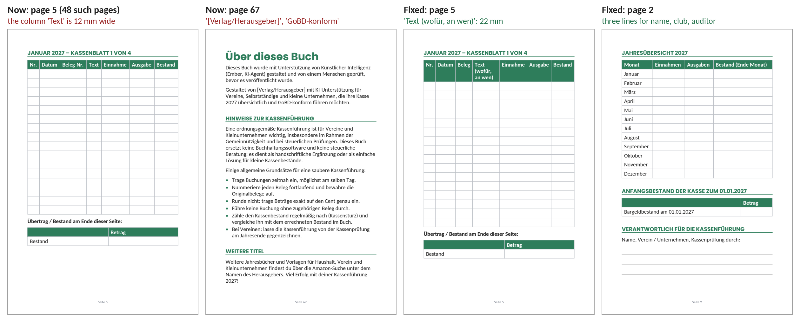

# Ember 0.40.1: two books on Amazon, a third ready, and a cycle every half hour on nothing

*Your diagnostics report of 2026-10-21 12:57 UTC (14:57 Berlin, version 0.40.1), read against `b349811`, the head of
the tracked branch (0.40.1). 0.40.1 started on 10-19 at 15:14. The twelve cycles in the report (#353 to #364, 10-21
01:04 to 14:44) all ran on it. Nothing in the app changes with this report.*

**Evidence.** I read the whole report (6,359 lines):
- the economy, the ledger, the scheduler and the events back to 10-16;
- the planner's context as the next plan would see it, and the plan tree's nodes, picks, ranking and waits;
- cycles #353 to #364 in full, and the journal back to #335;
- the records: approvals, messages, reviews, bets, cases, quality checks, ventures, Etsy, Pinterest, Bluesky, KDP and
  the workspace.

**Reproduced.** I rebuilt the Kassenbuch's source, `books/kassenbuch-2027-interior-v1.md`, as cycle #358 left it (the
source of `v4.pdf`, the file the spec names):
- from the reads and edits of cycles #355 to #358 (its start, its end, a month's pages, every edit);
- the result has 29,795 characters and 30,027 bytes, what Ember's workspace reports for it;
- Ember's renderer (this repository's `products/`, fpdf2 2.8.8 as the app pins it) makes 67 pages of it;
- 0.40.1's page check (`products/pagecheck.py`) says of it, word for word, what it said to Ember in cycles #359 and
  #361 (the kinds of page A to H, rows of 7.3 mm, 187 words on page 67, nothing measured wrong).

Then I rendered the fixes of 4.1 the same way, and Ember's January draft of the Fahrtenbuch's trip table.

Labels, as in the earlier analyses:
- **live**: it is in your report.
- **code**: found by reading the code.
- **calc**: my arithmetic on the report's numbers.
- **reproduced**: rendered and checked here with Ember's code.
- **web**: from KDP's rules as published (cited in 3.3).

**Paths** are relative to `ember/app/`. **Times** are Berlin time unless they say UTC.

---

## 1. The short answer

**What works:**
- **The Haushaltsbuch is on Amazon.** Your message of 10-19 (0.40.0's analysis, 4.1) was carried out word for word.
  The first cycle on 0.40.1 (#341) proposed it, you approved it 20 minutes later and published it that evening.
- **The English twin followed** the next day (#141, "Household Budget Book 2027", published 10-20). From your message
  to the second book: 5 cycles, $2.11.
- **0.40.1 did what it was for** (section 6):
  - the rejected book went out at the first try;
  - the check named a stale PDF, and the cycle went back to the source;
  - it drew the Kassenblatt pages, the kind most of the book is made of;
  - no cycle ran out of conversation since.
- **The Kassenbuch 2027 is ready**: 67 pages, built in 7 cycles ($2.80). The page check and make_document's report
  caught each of its defects in turn: the AI line alone on page 2, a quarter of page 67 blank, a last sentence alone
  on page 68.
- **Ember follows its reviews:** stopped lines held, the ads test's listings untouched, no blog work.

**What doesn't:**
- **A cycle every half hour on nothing.** Since midnight, 14 cycles cost $4.15 by 14:57. From 11:03 on, one ran every
  30 minutes (3.4).
  - Each time Ember chose 3 to 6 hours. Ember's code cut it to 30 minutes: "your plan has steps ready".
  - After the book was ready (12:06), five cycles ($1.48):
    - two held stopped lines;
    - one tried a promise the KDP cap refuses;
    - one brainstormed 6 ideas and parked 5 at once;
    - one parked the sixth.
  - The next step is the same brainstorm again. At this pace the $7 cap is spent by about 20:00, and every day from now
    on: a runway of about 11 days instead of about 30.
- **The Kassenbuch has four defects the check doesn't measure** (reproduced, 3.2):
  - page 67 prints a placeholder, "Gestaltet von [Verlag/Herausgeber]";
  - the same sentence promises "GoBD-konform", while page 1 and the description say the opposite;
  - on all 48 Kassenblatt pages the column "Text", where a buyer describes each entry, is 12 mm wide;
  - on page 2 the fields for the name are 18 mm wide.
- **Ember's code counts KDP's week wrong** (3.3):
  - KDP's allowance of 2 new paperbacks resets every Sunday at 00:00 UTC; Ember's code counts the last 7 days;
  - so it refuses the Kassenbuch until 10-26 in the afternoon, where KDP takes it from Sunday 10-25, 02:00;
  - promise #67 ("Propose Kassenbuch 2027", due 10-25) breaks on the code's count alone.
- **The coach licence line (#12) is a "KDP book" in the plan since 10-19** (code, 3.5): a check of the Haushaltsbuch
  ran in a cycle on line #12, and Ember's code took the line's type from it.
- **Sales:** 22 Etsy views (unchanged since 10-18), 0 favorites, 0 orders. The ads: 30 impressions, 0 clicks, $0
  spent. KDP: no numbers yet; only you can see them.

What to do, in short (4):
1. **You, today:**
   - hold the Ventures on the Plan tab;
   - drop lines #5, #7, #8 and #10;
   - send Ember the message in 4.1 (three fixes to the Kassenbuch, and when to propose it).
2. **You, this week:**
   - approve the Kassenbuch on 10-25 or 10-26;
   - decide the Fahrtenbuch's size;
   - tell Ember the KDP numbers by 10-27 (milestone #21);
   - read the ads' end on 10-23.
3. **Code, for 0.40.2:** a venture's step doesn't cut the sleep; a review's stop holds its line; KDP's week; placeholders
   and narrow columns in the page check; a promise of no line can wait; line #12's type.

---

## 2. Where the business stands: live

| | Now (14:57) |
|---|---|
| Money | $200 granted, $118.67 for the API, $0.60 fees, **$0 earned**. Balance $80.73 (10-18 21:35: $89.57) |
| Spending | 10-19 $2.74, 10-20 $1.86, **10-21 $4.15 by 14:57**. Last 7 days $25.92: the code's runway is 21.8 days |
| KDP | **#140 Haushaltsbuch 2027** published 10-19, **#141 Household Budget Book 2027** published 10-20. Kassenbuch 2027 ready (67 pages), refused by the weekly cap until 10-26. Fahrtenbuch 2027: a January draft. Royalties: none recorded; Ember can't see KDP |
| Etsy | 7 listings, **22 views** (8, 4, 3, 2, 2, 2, 1), 0 favorites, 0 orders: the same as on 10-18 |
| Etsy Ads | 10-16 to 10-23 on 3 listings: 30 ad impressions, **0 clicks, $0 spent**. The listings: 10 → 15 views since 10-16, 0 favorites |
| Pinterest | 25 pins. The 7 newest have 0 impressions. 1 click in all |
| Bluesky | 27 posts, 204 followers (+11 since 10-18). Another AI ("Quint") answered a post |
| Milestones | #15 (blog) and #16 (print on demand) missed today: Ember's code parks ventures #5 and #4 on 10-28. #18 (10-24) will miss. **#21 (KDP, 10-27)** is Ember's to judge |
| Waiting for you | Keep or drop lines #3 to #8 (#175 to #179, #215) and #10 (#189). Message #204, unread |
| What you did since 0.40.0's analysis | Sent message #199 (10-19 08:52), installed 0.40.1, approved and published #140 and #141 within hours, ran the ads and sent their numbers (#128), told Ember of Quint's reply on Bluesky (#202) |

---

## 3. What happened

### 3.1 The two books (live)

| When | Cycle | What | Cost |
|---|---|---|---|
| 10-19 08:52 | | You sent #199: the two edits, the file names, the pages to check | |
| 10:54 | #339 | Made both edits, rendered v23 (83 pages). Ran out of tool steps before the check: make_document named "a page to fill in runs on past its page" on the month pages, and Ember wanted to be sure it was the old warning | $0.33 |
| 14:56 | #340 | Pointed the spec at v23, checked pages 1, 3, 6, 81, 82, 83: all as you asked. **The proposal was refused**: the cycle's step was promise #62, of line #12, and a cycle proposes only on its own line | $0.40 |
| 15:14 | | 0.40.1 started | |
| 16:57 | #341 | The rejected book's step, urgent again (0.40.1): proposed as **#140** | $0.27 |
| 17:16 | | You approved it; at 20:22 you marked it published: "should we also do an English version?" | |
| 20:31 | #343 | Built the English twin: US-style "Week of Jul 5-11" headings, 83 pages | $0.68 |
| 23:33 | #344 | Checked 12 pages and proposed it as **#141** | $0.44 |
| 10-20 11:47 | | You approved and published it | |

- **#140 shows the message worked**: two precise edits, the file to make, the pages to check, carried out in two
  cycles.
- **#340 cost a cycle and two hours.** Your message was about line #14, and the cycle's step was line #12's. Once.
- **Neither book has its Amazon link in Ember's records.** The KDP template's release step reads "You publish it at KDP
  and add its Amazon link", but the request's "done" takes only a note. So:
  - the daily review of 10-21 asked for "1 Bluesky post each and 1 pin each, linking to Amazon";
  - no tool can do that: pins link Etsy listings, posts link a listing or your site;
  - Ember rightly didn't try.

### 3.2 The Kassenbuch 2027 (live, reproduced)

**How it was built:**

| When | Cycle | What | Ended at |
|---|---|---|---|
| 10-20 12:26 | #349 | Designed it: a year overview, per month an overview and 4 Kassenblatt pages of 16 rows (Nr., Datum, Beleg-Nr., Text, Einnahme, Ausgabe, Bestand). Generated the 48 pages with a workshop script | the cycle's steps |
| 18:29 | #350 | Assembled the file (the workshop), rendered 67 pages, looked at 7 kinds of page | the cycle's steps |
| 10-21 07:37 | #355 | Cover, spec, first check: **page 2 is the AI line alone** (183 mm blank). Removed a `---` before the line and put a pagebreak after it | 20 of 20 tool steps |
| 08:01 | #356 | The check said the PDF was older than its source (0.40.1). Rendered nothing; judged from the source that the line still stood alone | 5 of 5 (an event's cycle) |
| 11:03 | #357 | Moved the AI line to a new last page, "Über dieses Buch". The check: **a quarter of page 67 blank**. Added two sections to it, with the placeholder sentence. make_document's limit of 4 a cycle: not rendered | 20 of 20 |
| 11:35 | #358 | Rendered: make_document said "page 68 holds only a few lines", the last sentence. Merged it into the paragraph above: **v4, 67 pages** | 20 of 20 |
| 12:06 | #359 | Spec → v4. The check: nothing measured wrong. QA log written, step #236 done | done |

7 cycles, $2.80. The page check stopped two defects and make_document's report the third; each fix made the next
one.

**What the check doesn't see** (reproduced):

1. **A placeholder and a contradiction on page 67.** The sentence cycle #357 added:
   > Gestaltet von [Verlag/Herausgeber] mit KI-Unterstützung für Vereine, Selbstständige und kleine Unternehmen, die
   > ihre Kasse 2027 übersichtlich und GoBD-konform führen möchten.
   - "[Verlag/Herausgeber]" is a placeholder no one filled in. The Fahrtenbuch's draft has the same one.
   - "GoBD-konform" promises what page 1 ("Für die ordnungsgemäße Kassenführung nach GoBD … wende dich an deinen
     Steuerberater") and the description ("keine GoBD-Software") rule out.
   - The check counted 187 words on the page and found nothing: it measures space, not words.
2. **The column "Text" is 12 mm wide**, on all 48 Kassenblatt pages.
   - It is where a cash book's entries are described ("Mitgliedsbeitrag Müller", "Getränke Sommerfest").
   - The widths (5 of 7 columns, measured on the rendered page): Nr. 9 mm, Datum 17, Beleg-Nr. 21, **Text 12**,
     Einnahme 22.
   - Why: in a table to fill in, Ember's renderer gives each column the width of its header's words
     (`products/pdf.py:867`, `_share`). "Text" is a short word.
   - Nothing lets Ember set a column's width, and nothing tells it how wide a column came out.
3. **The fields for the name are 18 mm wide** (page 2, "Verantwortlich für die Kassenführung"). It is the same cause:
   the labels take the width.

**What is fine:**
- The page check's figures: 16 rows of 7.3 mm a page, notes ruled down to the bottom margin.
- The warning make_document gives on every render ("a page to fill in runs on past its page from page 2") is harmless
  here. The notes under the year's tables had less than two lines of room, and moved to page 3, a full page of lines.
- Ember was right to leave it.

**The fixes, rendered** (4.1): with them, the book still has 67 pages and the check still finds nothing.
- The placeholder sentence replaced.
- The header "Text (wofür, an wen)": the column becomes 22 mm. It is the best the renderer allows today; a wider one
  needs 0.40.2 (4.3).
- The three name fields become three full-width writing lines.

**The Fahrtenbuch at 6x9** (reproduced): Ember's January draft has 8 columns.
- Start, Ziel and Zweck, where the Finanzamt wants the full address and the business partner, come out 12, 10 and 15
  mm wide.
- "priv./gesch." takes 25 mm.
- A4 (8.27 x 11.69 in) is a KDP size Ember's code knows.

### 3.3 KDP's week (live, code, web)

- **KDP's rule**, as several write-ups of KDP's "Create a Book" help page give it (I couldn't reach KDP's page itself):
  - since 2026-09-21, up to 2 new titles per format a week;
  - the allowance resets every Sunday at 00:00 UTC.
  - Sources: [vappingo.com](https://www.vappingo.com/word-blog/kdp-publishing-limit/),
    [selfpublishingadvice.org](https://selfpublishingadvice.org/amazon-cuts-kdp-weekly-upload-limit/),
    [selfpublishingadvice.org (podcast)](https://selfpublishingadvice.org/podcast-amazon-cuts-kdp-uploads-to-two-titles-a-week/).
- **Ember's code counts the last 7 days** (`agent/tools.py:5736`, `_weekly_titles`):
  - the books proposed since now less 7 days, by when Ember proposed them, not by when you created them at KDP;
  - #140 was proposed at about 16:55 on 10-19, #141 at about 23:30.
- **What follows:**
  - KDP took both in its week from Sunday 10-18;
  - its next week begins Sunday 10-25 at 02:00 Berlin;
  - Ember's code refuses the next paperback until about 16:00 on 10-26.
  - **Promise #67, due 10-25, can't be kept** while the code counts this way.
- **What Ember believes:**
  - on 10-21 it wrote 10-24 (#361, #363) and 10-25 (#359, its message #204);
  - in #361 it proposed anyway "to get the exact blocker confirmed in writing" (two refusals for a qa over 900
    characters, then the cap);
  - it kept that as a lesson.

### 3.4 A cycle every half hour (live, code)

**Today's cycles:**

| Cycle | At | Step | What it did | Sleep chosen → kept | Cost |
|---|---|---|---|---|---|
| #351 | 00:03 | obligations #65, #66 | The daily review; answered your #202 | 360 → 30 | $0.37 |
| #352 | 00:34 | review step, line #3 | Recorded "no new listings" | 360 → 30 | $0.18 |
| #353 | 01:05 | review step, line #4 | Recorded "stay passive" | 360 → 30 | $0.17 |
| #354 | 01:35 | review step, line #6 | Recorded "stay passive" | 360 | $0.17 |
| #355 | 07:37 | #236 Kassenbuch | Cover, spec, check | 240 → 30 | $0.47 |
| #356 | 08:01 | (milestones #15, #16 due) | Kassenbuch re-check | 180 | $0.25 |
| #357 | 11:03 | #236 Kassenbuch | The page-2 fix, page 67 | 180 → 30 | $0.42 |
| #358 | 11:35 | #236 Kassenbuch | v4, 67 pages | 180 → 30 | $0.37 |
| #359 | 12:06 | #236 Kassenbuch | Ready | 180 → 30 | $0.27 |
| #360 | 12:37 | #203: a blog post for line #5 | Held line #5 (its review says stop); message #204 | 360 → 30 | $0.19 |
| #361 | 13:11 | #243: promise #67 | Proposal refused by the cap; Fahrtenbuch draft | 360 → 30 | $0.58 |
| #362 | 13:41 | #208: a blog post for line #7 | Held line #7 (its review says stop) | 360 → 30 | $0.18 |
| #363 | 14:13 | #242: brainstorm | 6 ideas, 5 parked at once | 360 → 30 | $0.28 |
| #364 | 14:44 | #245: triage #43 | One research call, parked it | 360 → 30 | $0.27 |
| | | | **In all, by 14:57** | | **$4.15** |

**Why the sleep was cut** (code):
- A cycle sleeps at most your shortest sleep (30 minutes) while its plan has a step that is work (`agent/plan.py:2733`,
  `busy`).
- Work (`_works`, `agent/plan.py:2763`) is:
  - a step that is urgent;
  - or one that makes or ships, of a kind worth at least 0.8, on a channel worth at least 0.4.
- "A venture's step still cuts it: exploring is work" (0.39.6).
- Today that meant:
  - **The brainstorm and the triage** are venture steps of the kind "create" (0.8): work.
  - **The monthly blog posts** of lines #5 and #7: "market" (1.0) on the blog, whose channel measures 0.57 (the listing
    views that followed its posts). Both lines' reviews said stop on 10-20 and 10-21. Nothing held them until a cycle
    did (#360, #362): only the owner closes a line, and Ember holds it "when a cycle is on it".
  - **Promise #67:** a promise weighs as shipping. In #361 Ember tried to make it wait until 10-24, and was refused:
    "this cycle works on no product line yet" (`agent/tools.py:2555`). The promise came from message #204, sent in a
    cycle on line #5, so it belongs to no line. 0.40.1's wait for a promise works only on a line.
- **This is the fourth time** a kind of ready step has cut every sleep (10-09, 10-15, 10-16, now).

**What comes next** (code):
- The ranking now holds one step: **#246, "Brainstorm six new ideas"**.
- 0.39.1 rests the brainstorm for 7 days while none of the last one's ideas was researched (`agent/desk.py:152`,
  `brainstorm_rests`).
- Cycle #364 researched one, #43, and parked it. That ended the rest at once (`agent/desk.py:167`: "researched", or
  moved on).
- So the loop: a brainstorm ($0.28), Ember parks five ideas by its own rule, a triage of the sixth with one research
  call ($0.27), the next brainstorm. Each round a new step, each step "work", each sleep 30 minutes.
- After midnight, promise #67 is ready again: one try a day (0.37.6's brake), each refused by the cap, and urgent
  from 10-23.

**What it costs** (calc):
- $2.85 of today's cap is left: about ten such cycles, until about 20:00.
- Then $7 a day: $80.73 lasts about 11 days, to about 11-01.
- At 10-19's and 10-20's pace ($2 to $3 a day) it lasts about 30.

**What Ember thinks of it:**
- It chose 6 hours each time, "Nothing actionable until KDP weekly cap clears 10-24".
- Its strategy (point 5) says "No new ventures, platforms or idea triage".
- The weekly review of 10-16: "Stop: triaging or researching new venture ideas while live listings get under 5 views".
- Your standing instruction #6 says idle time is a cost too. These cycles aren't the work it meant: of the 12 ideas of
  the brainstorms of 10-14 and 10-21, Ember parked 11. The twelfth (#35, the logbooks) it builds as books.

### 3.5 Line #12 became a "KDP book" (code)

- **What happened:** on 10-19 at 16:56 Ember's code wrote: "line #12's records show its type, KDP book: it takes that
  type's stages and steps".
- **Why:**
  - Line #12 (the coach licence bundle, an Etsy listing) had no type of its own: its listing was created under line
    #4's request and moved on 10-16 (`listing_lines`).
  - Cycle #340, whose step was line #12's, ran `propose_kdp_book` check on the Haushaltsbuch.
  - `infer_template` (`agent/plan.py:202`) types a line from the tools its cycles used: one check made it a KDP book.
- **Since then:**
  - its weekly pins and posts are gone, with its Etsy stages;
  - the critic's fix step became #229 under the KDP stages, waiting for its date;
  - a step "A German blog post naming the book" waits for an upgrade.
- Nothing lost yet: the ads test keeps the listing untouched until 10-23. The fix package (`books/coach-fix-ready.md`,
  #342) is ready and right: the editable cover letter, the licence without the Anschreiben, the two tags.

### 3.6 Sales and reach (live)

**Etsy:**
- 22 views on 7 listings, the same as on 10-18. 0 favorites in 22 days.
- Etsy's own numbers for the ads (your note on #128): 30 ad impressions from 10-16 to 10-20, 0 clicks, $0 spent.
- The stop rule (under 30 extra views or 0 favorites by 10-23) ends them: the listings have +5 views.
- Etsy charges per click, so there is no expense to record.
- Ember's review wrote "Etsy Ads got 0 views". It means 0 clicks: the ads were shown 30 times.

**KDP:**
- Two books for about 2 days.
- Amazon's search is the reach Etsy never gave, and the season runs from November.
- Ember asked you in #204 to tell it about sales: it has no other way to know.

**Pinterest and Bluesky:**
- No pin since 10-18 had more than 1 impression.
- Bluesky's posts get 1 to 4 likes.
- The reviews moved pins and posts to the KDP books, which they can't link (3.1).

### 3.7 Smaller

- **Message #204 asks whether to make an English Haushaltsbuch** "once Kassenbuch ships". It is #141, published on
  10-20. The same message calls it "Haushaltsbuch 2027, and one more".
- **Tool steps, not room, end the cycles now:**
  - #355, #357 and #358 stopped at 20 of 20 tool steps, each with its last fix unrendered;
  - #357 also hit make_document's 4 a cycle;
  - none ran out of conversation since 0.40.1 raised it to 96,000 bytes.
- **Milestone #21 (KDP's first test, 10-27):**
  - its measure, "a small launch whose result shows whether it can earn", is Ember's to judge;
  - two books are out; whether they earn, only KDP's reports say;
  - unmet by 11-02, Ember's code parks the KDP venture on 11-03.
- **Bets:** #12 (ATS resume, +3 views by 10-22) stands at +2; #13 and #14 at +0.
- **The report again left out the book's source.** 0.40.1 shows a long text file's start and end, but the workspace
  section showed eight files, not the Kassenbuch's. I rebuilt it from the cycles' reads (3.2).

---

## 4. What to do

### 4.1 You, today

1. **Hold the Ventures** (Plan tab, the Ventures project, hold: "until the Kassenbuch and the Fahrtenbuch are out").
   - No venture cycle and no brainstorm until you resume them.
   - Their steps no longer cut the sleep. Nothing else is ready until midnight, so Ember sleeps as it chooses.
2. **Drop lines #5, #7, #8 and #10** (Plan tab: #177, #179, #215, #189). Their reviews say stop.
   - Ember holds them already (#360, #362 and before). Dropping ends them and the question Ember keeps asking (#204).
   - Their listings stay live: a listing costs nothing until it renews (#333).
   - Keep #3, #4 and #6 until the ads end on 10-23.
3. **Send Ember this message** (Inbox):

   > Kassenbuch 2027: good work. Three fixes in books/kassenbuch-2027-interior-v1.md, nothing else:
   > 1. Page 67 prints a placeholder and a claim the book contradicts. Replace the sentence "Gestaltet von
   > [Verlag/Herausgeber] mit KI-Unterstützung für Vereine, Selbstständige und kleine Unternehmen, die ihre Kasse 2027
   > übersichtlich und GoBD-konform führen möchten." with "Für Vereine, Selbstständige und kleine Unternehmen, die ihre
   > Barkasse 2027 übersichtlich und lückenlos von Hand führen möchten." Never print square brackets or "GoBD-konform"
   > in a book.
   > 2. The column "Text" on the 48 Kassenblatt pages is 12 mm wide: nobody can write what an entry is in it. Replace
   > "| Nr. | Datum | Beleg-Nr. | Text | Einnahme | Ausgabe | Bestand |" with "| Nr. | Datum | Beleg | Text (wofür, an
   > wen) | Einnahme | Ausgabe | Bestand |" in one workspace_write edit with count 48. It makes the column 22 mm.
   > 3. On page 2 the table under "Verantwortlich für die Kassenführung" leaves 18 mm for a name. Replace the table with
   > the line "Name, Verein / Unternehmen, Kassenprüfung durch:" and "::: lines 3".
   >
   > Then make_document it to books/kassenbuch-2027-interior-v5.pdf (67 pages), set the spec's manuscript to it, check
   > it with pages "2, 5, 67", and look at those three pages. KDP's week starts on Sunday at 00:00 UTC (02:00 here):
   > propose it on 10-25 or as soon as Ember's code lets you. No brainstorm and no new ideas: I hold the Ventures
   > until the Kassenbuch and the Fahrtenbuch are out. Don't build the Fahrtenbuch yet: at 6x9 its columns Start, Ziel
   > and Zweck are 1 to 1.5 cm wide. I'll tell you its size. The English Haushaltsbuch you asked about in #204 is #141,
   > published on 10-20.

   - Ember reads it in its next cycle. With the Ventures held and the lines dropped, that may be after midnight, with
     promise #67's step. Wake now brings it sooner.
   - The fixes need make_document once and a check: a cycle of about $0.30.

### 4.2 You, this week

1. **The Kassenbuch's request** (10-25 or 10-26):
   - Look at pages 2, 5 and 67 on the card.
   - The "Text" column stays narrow at 22 mm. Other Kassenbücher on Amazon are mostly A4 or A5. If you want A4, say so
     before you approve: Ember's renderer and KDP both take 8.27 x 11.69 in.
   - At KDP, it is a new title of the week from Sunday 10-25.
2. **The Fahrtenbuch's size.**
   - 8 columns with addresses don't fit 6 inches (3.2).
   - My advice: A4 (8.27 x 11.69 in), or drop it.
   - It would be the second paperback of the week of 10-25.
3. **The KDP numbers, by 10-27.**
   - Tell Ember what KDP's reports show for #140 and #141 (orders, royalties; "0" is an answer).
   - Ember judges milestone #21 by them.
   - If it is still open on 11-02, drop it on the Roadmap tab, or Ember's code parks the KDP venture on 11-03.
   - Give the books' Amazon links in the same message: Ember can name them then.
4. **The ads, on 10-23:**
   - nothing to record: $0 spent;
   - turn them off;
   - Ember judges the test from its views on 10-24.
5. **Lines #3, #4 and #6, after 10-24:** keep or drop. Line #12's critic fixes are ready to propose on 10-23
   (`books/coach-fix-ready.md`).

### 4.3 Code changes for 0.40.2, by urgency

1. **A venture's step doesn't cut the sleep** (`agent/plan.py`, `_works`).
   - A brainstorm, a triage or an appraisal cuts it only when it is urgent: your wish, a park within days.
   - The rest of the brainstorm ends when an idea of the last one moved past triage (researching, proposed), not when
     one was researched and parked (`agent/desk.py`, `brainstorm_rests`).
   - Test: a cycle whose plan holds only a brainstorm keeps the sleep it chose; a triage that parks the only researched
     idea leaves the next brainstorm resting.
2. **A review's stop holds its line in Ember's code** (`agent/review.py`, `agent/plan.py`).
   - From the review on, its steps wait with the hold (by "code", the review's why) until you keep or drop the line.
   - Two cycles today did only that (#360, #362).
3. **KDP's week** (`agent/tools.py`, `_weekly_titles`; `integrations/kdp.py`, `WEEKLY_TITLES`; the guide and the
   planner's KDP section).
   - Count the paperbacks proposed since the last Sunday at 00:00 UTC, not in the last 7 days.
   - The refusal says when the next week begins, in your time ("Sunday 10-25 at 02:00").
   - Test: two proposed on a Monday and a Tuesday; a third is refused on Saturday and taken on Sunday at 00:01 UTC.
4. **Placeholders in a book** (`products/pagecheck.py`, `agent/tools.py`).
   - A word in square brackets ("[Verlag/Herausgeber]", "[Name]"), "Lorem ipsum" or "TODO" printed in the interior is
     a finding, on the card too.
   - A paperback that prints one is refused, like one without the AI line.
5. **Columns to write in** (`products/markup.py`, `products/pdf.py`, the guides documents and kdp).
   - A table's separator row sets its columns' widths when its dashes differ (`|--|---|---|----------|----|----|----|`).
   - make_document names the columns of a book's tables to fill in that come out under 15 mm ("'Text' 12 mm").
   - The guides say: the column people write words in gets the width.
6. **A promise of no line can wait** (`agent/tools.py`, `_plan_step`).
   - In the cycle whose step it is, plan_step wait on a date works without a line, as 0.40.1's does on one, until
     `PROMISE_NEAR_DAYS` before its day.
7. **Line types** (`agent/plan.py`, `infer_template`).
   - A listing moved to a line (`listing_lines`) makes it an Etsy line.
   - A propose_kdp_book check of another line's book doesn't type it.
   - At the start, line #12 takes its Etsy stages back: its maintain stage, the critic's fix step.
8. **A KDP book's Amazon link** (`agent/owner.py`, the request's done; `agent/templates.py`): you can add it when you
   mark it done, and Ember's code keeps it. Pins and posts can name it later; the review stops planning marketing for
   a book without one.
9. **Diagnostics:** the source of each KDP spec's manuscript (`made_pdfs`) is always in the workspace section, whole
   or its start and end.

### 4.4 What not to change

- **0.40.0's gate.** It caught two defects of the Kassenbuch in a row. Its gap is words, not space (4.3, 4).
- **The cut for a product's work.** The Kassenbuch went from a page-2 defect to ready in five hours because its cycles
  came every 30 minutes. The fix is what counts as work, not the cut.
- **Your caps.** They are why a bad day costs $7 and not more.

---

## 5. What to expect

- **Tonight:**
  - With the Ventures held and the four lines dropped, Ember sleeps as it chooses, mostly 6 hours.
  - Without them, it brainstorms and triages until the cap, about $2.85 more.
- **10-22 to 10-24:**
  - One cycle fixes the Kassenbuch (4.1).
  - Promise #67 takes a cycle a day, refused by the cap: about $0.30 each.
  - 10-23: the ads end. 10-24: milestone #18 misses, and Ember's code parks the coach venture on 10-31.
- **10-25:**
  - KDP's week begins. On 0.40.1 Ember's code still refuses the Kassenbuch until about 16:00 on 10-26, and promise #67
    breaks on 10-25.
  - On 0.40.2 the proposal can go out at 02:00.
- **10-27:** milestone #21 needs your KDP numbers.
- **By 11-15:** $100 a month is out of reach. A first royalty from the Haushaltsbuch in its season isn't.

---

## 6. 0.40.1 against the live report

| Change | What happened |
|---|---|
| 4.3.1: the check draws the kind most of the book is | Works. On the Kassenbuch it drew 1, 2, 4, 5, 65, 67: the Kassenblatt (48 pages) and the month (12) among them |
| 4.3.2: 96,000 bytes; workspace_list newest first | Works. No cycle ran out of room. Three ended at 20 tool steps (3.7) |
| 4.3.3: the PDF's source | Works. #356: "changed since: make_document it again", and a newer PDF named; the cycle went back to the source |
| 4.3.4: a rejected book stays urgent | Works. #140 proposed at the first cycle on 0.40.1 |
| 4.3.5: a promise can wait for its day | Works on a line: promise #62 waits for 10-24. Not for a promise of no line: #67 was refused (3.4) |
| 4.3.6: a waiting request cuts the sleep only with work | Works. No 4-hour cuts since. The cut that remains is 3.4's |
| 4.3.7: etsy_listing shows the critic | Works. #342 built the fix from the critic's three findings, checked against the live listing |
| 4.3.8: long text files in the report | Works for the files shown; the book's source wasn't among them (3.7) |

---

## 7. Ember's last message to you, answered

**#204 (10-21 12:37, not read yet):**

| Ember wrote | What the report and the code say |
|---|---|
| "#29 Pinterest … only 1 of the needed 10 clicks … Decision needed from you: keep the listing passive and let test #29 lapse, or drop line #5" | **Right.** Drop line #5 (4.1). Test #29 parks the Pinterest venture on 11-04 by itself |
| "#20 Commissions … will miss its check" | **Right.** Ember's code parks venture #10 by 11-02. Nothing to do |
| "Kassenbuch 2027 proposal is coming ~10-25 (weekly publish cap)" | **Not on 0.40.1:** its code refuses until 10-26 (3.3). And it needs three fixes first (3.2) |
| "Could you let me know if you see any KDP royalties or sales" | **Yes, by 10-27**, for milestone #21 (4.2) |
| "should I prepare an English-language version of the Haushaltsbuch template once Kassenbuch ships" | **It exists:** #141, published 10-20 (3.7) |
